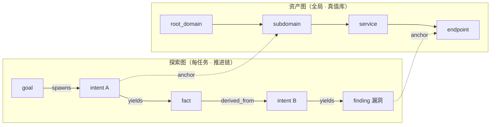
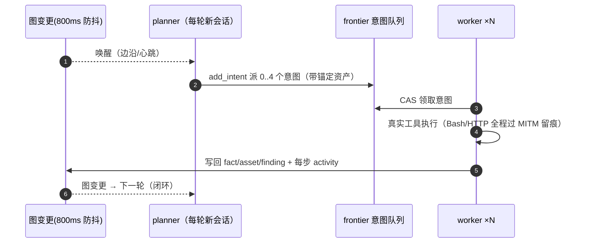
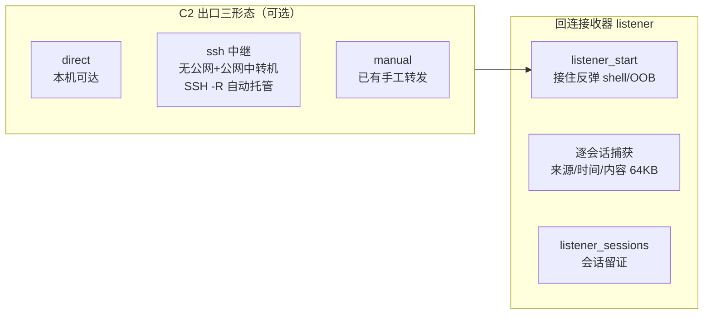

<div align="center">

# ARTEX

**AI 自主渗透测试 · 红队作战平台**

Go 单体后端（内嵌 Next.js 前端）· PostgreSQL · 多 Agent 自主推进 · 全程证据留痕

🌐 **在线 Demo**： [https://artex-demo-ruoji6.vercel.app/](https://artex-demo-ruoji6.vercel.app/)

</div>

本仓库为独立维护的 [RuoJi6/ARTEX](https://github.com/RuoJi6/ARTEX)，保留 https://github.com/Autumn-27/ARTEX 的原始提交历史与 AGPL-3.0 许可证。程序发布包从本仓库 Releases 下载，Docker 镜像 [ruoji6/artex](https://hub.docker.com/r/ruoji6/artex) 由本仓库 GitHub Actions 构建并发布。

---
## 致谢
致谢米斯特安全团队

## 这是什么

ARTEX 是一套 **LLM 多 Agent 自主渗透测试平台**：你给一句话目标，它自动完成
「目标拆解 → 侦察 → 漏洞挖掘 → 利用 → 后渗透 → 报告」全流程，人随时可以插手纠偏。

与本仓库**前一版本**（接手自已删除的原作者项目 `Autumn-27/ARTEX`，基于其最终定版
v0.3.15）相比，现在的 ARTEX 已经是**完全独立演进的新项目**——原作者的代码留在
git 历史里作为起点，v0.3.16 以来的 **160+ 提交、约 4 万行新增**全部由本仓库的
维护者完成，覆盖了原作者版本没有的整条能力线：

| 能力线 | 本版本做了什么 |
|---|---|
| **漏洞情报运营** | NVD / CISA KEV / GitHub Advisory / PoC 聚合 / nuclei 模板联动 / 资产指纹→CVE 反向匹配 / **近期高危快通道**（30 分钟一轮）——原作者版本完全没有情报层 |
| **红队作战** | TCP 回连接收器（接住反弹 shell 并留证）/ **C2 出口三形态**（direct / SSH 中继托管 / manual）/ redteam-ops 后渗透方法论 skill / 9 件后渗透工具（socat/proxychains/ligolo/linpeas/pspy/evil-winrm…） |
| **安全与合规** | 登录防爆破（IP 锁定+全局限流）/ 探活端点去指纹 / 改密码即吊销全部会话 / 安全响应头 / 认证面无产品名——**公网部署基线** |
| **工程可靠性** | LLM 三通道轮询（熔断+故障转移+用量归因）/ 拆解墙钟 / planner 双保险 / 任务收官 / 一键更新（校验+回滚） |
| **工具与交付** | 宿主工具 54+ 件**一键装齐** / 漏洞 19 类标准枚举 / Word 报告导出 / 证据版本化+sha256 校验 / 手机端适配 |

原作者版本有的核心（双图架构、planner/worker 编排、MITM 流量代理、审批门）全部
保留并在其上加固；下文详述。

---

## 截图预览

| 仪表盘（总览 / Token 消耗 / 活动流） | 任务列表 |
| :---: | :---: |
|  |  |

| 任务 · 执行过程（会话 / 工具调用） | 探索链路 |
| :---: | :---: |
|  |  |

| 发现 | 资产 |
| :---: | :---: |
|  |  |

| 资产覆盖图（力导向布局 · 已测高亮） | 流量录制 |
| :---: | :---: |
|  |  |

| Agent 管理 | LLM 配置 | 拦截审批 | 后端日志 |
| :---: | :---: | :---: | :---: |
|  |  |  |  |

---

## 核心设计

### 双图架构：资产图 × 探索图

渗透测试的全部状态拆成两张独立、由锚点缝合的图：

- **资产图**（全局共享）：`root_domain / subdomain / ip / service / app / endpoint`
  六类节点的真值库，跨任务复用；公司归属 + 授权边界（task_scope）挂在这里。
- **探索图**（每任务一份）：`goal → intent → fact / finding` 的推进链，五种边
  （spawns / derived_from / yields / proves / covers）构成**血缘**——「这个发现
  是从哪条线索推出来的」全程可回溯，这是**报告可信度的根基**。



### 多 Agent 自主推进



- **planner** 是唯一意图生成者，持有一份跨唤醒共享的 todolist——串行利用链
  （注入点→凭据→横向）记录一次、按依赖逐步派发，不重复不错序。
- **worker** 做完一条意图即停；结果写回双图后自动唤醒 planner。
- **空转收场 / 拆解墙钟 / 规划轮超时 / model_error 重跑** 多层韧性：免费限流
  通道也能稳定跑完任务（三通道轮询 + 故障转移 + 熔断实测）。
- **人在环路**：对话纠偏 / 意图暂停取消 / 人工审批 / `steer_work` 实时纠偏，
  每步 activity 在 UI 内联可见。

### 漏洞情报运营（持续，不是静态知识库）

多数同类产品的情报是「按组件查」；ARTEX 做的是「**按时间流**」——
**最近 7 天爆了什么 → 匹配我的资产 → 排进任务**：

- NVD 全量/增量 + **CISA KEV 在野利用** + **GitHub Advisory**（版本区间第二来源）
  + GitHub PoC 聚合
- **近期高危快通道**：按发布时间每 30 分钟拉 CVSS≥9.0 或 KEV，几十分钟进库
- **资产指纹→CVE 反向匹配**：同步的 CVE 自动匹配资产 technologies 指纹，
  命中即向任务挂 hint
- **版本区间精确判定**：`search_vulns` 返回 `version_in_range` 三态；
  NVD 不填区间时 GHSA 补（保守判定：解析不出→「可能受影响」）

### 红队作战能力



- **回连接收器**：接住反弹 shell / OOB 回连，逐会话记录来源、时间、捕获内容；
  REST + agent 工具双入口；启停走人工审批（ask）。
- **C2 出口配置**：本机有公网→direct；无公网+公网中转机→SSH 反向隧道平台托管
  （断线自动重连）；已有转发→manual。`listener_start` 返回解析后的回连地址，
  agent 直接填 payload，无需自行判断网络形态。
- **redteam-ops skill**：后渗透六阶段方法论（落地稳定化→提权→权限保持→凭据
  获取→横向移动→数据获取回传→收尾）+ 证据纪律。
- **后渗透工具 54+**：impacket/netexec/evil-winrm/chisel/ligolo-ng/proxychains/
  socat/linpeas/pspy/responder/sqlmap/hydra/hashcat/nuclei/ffuf…全部可在
  「宿主环境」页**一键装齐**（特权助手 artex-hostd 串行排队执行）。

### 审批与拦截：三层闸门

| 层 | 语义 | 内置规则 |
|---|---|---|
| 明令禁止 `deny` | 任何语境都不可逆且无合法渗透用途——不调模型直接拒 | 10 条 |
| 交 Agent 研判 `judge` | 作用对象取决于上下文（删测试表 vs 删生产表）——命中后走模型裁决 | 12 条 |
| 人工确认 `ask` | 平台能力边界变更（如开监听端口）——转人工审批 | 1 条 |

- 规则级 timeout 真生效（研判类 90s/allow，硬禁类 30s/deny）；
- 模型裁决**严格 JSON 解析**（解析失败走失败策略，绝不猜）；
- 拦截原因带「平台管控」框架——防止 agent 把平台策略当目标防御来绕；
- 反注入边界：裁判输入刻意收窄（仅工具名+参数+工作目录），历史不进裁判视野。

### 全程证据链

- **MITM 记录代理**：worker 的全部 HTTP/S 流量逐请求留存（CA 签发留痕）；
- **发现绑定流量**：finding 可绑定 baseline/proof/verification/supporting 四类
  流量证据，快照版本化（sha256），报告引用可验证；
- **数据回传**：本机文件内容外传类命令有专属拦截规则（judge 研判）；
- **报告导出**：Word（OOXML 手写零依赖）按 19 类漏洞枚举折叠聚合；
- **对抗式自检**：换身份/换参数顺序/换客户端复现——「确认了才报」。

---

## 部署自己的在线 Demo（随正式 Release 自动更新）

Demo 只运行 `web/` 前端，构建时启用 `NEXT_PUBLIC_MOCK=1`，不需要 Go、PostgreSQL 或模型密钥。界面使用模拟数据，不执行真实扫描。

发布链路：正式版本的程序包、`SHA256SUMS` 和 Docker 镜像全部成功发布 → `release.yml` 的 `demo` job 调用 `demo.yml` → 检出该版本标签的提交 → 构建 Mock 前端 → 部署至 Vercel 的固定生产域名。普通 main 推送、仅创建标签、失败的发布、草稿和预发布版本都不会更新 Demo。新版本功能的演示数据仍需由维护者同步维护 `web/src/lib/mock/`。

### 首次配置 Vercel

1. 在自己的 Vercel 账号创建空项目，设置名称（例如 `artex-demo-ruoji6`）。保持 **Git 未连接**，避免每次提交都自动部署。`web/vercel.json` 也禁用了 Git 自动部署。
2. 在 **Settings → Build and Deployment** 中选择 **Next.js**、Node.js **22.x**，安装命令可覆盖为 `npm ci`，构建命令为 `npm run build`，Output Directory 保持默认。**Root Directory 留空**：此工作流从检出的 `web/` 目录调用 Vercel CLI，不能再填一层 `web`。
3. 在项目的 **Environment Variables** 中添加 `NEXT_PUBLIC_MOCK=1`，至少应用于 **Production**。不要设置 `NEXT_EXPORT=1`，也不要填写数据库连接或模型密钥。
4. 在项目 **Settings → General** 复制 **Project ID**；在团队 **Settings → General** 复制 **Team ID**（对应 `VERCEL_ORG_ID`）。确认 **Domains** 中有准备使用的生产域名。
5. 在 Vercel **Account Settings → Tokens** 创建部署 Token，范围选择项目所在团队，并设置适当有效期。将其直接保存到 GitHub 仓库 **Settings → Secrets and variables → Actions → Secrets**，名称为 `VERCEL_TOKEN`。令牌不要写入仓库、README 或聊天；到期后更新这个 Secret。

在同一 GitHub 设置页的 **Variables** 中添加：

| 变量 | 值 |
| --- | --- |
| `VERCEL_ORG_ID` | Vercel Team ID |
| `VERCEL_PROJECT_ID` | Vercel Project ID |
| `DEMO_URL` | 固定公开生产网址，含 `https://`，例如 `https://artex-demo-ruoji6.vercel.app` |

### 首次部署与重试

将配置合并到默认分支后，打开 **Actions → deploy-demo → Run workflow**，分支选 `main`，tag 留空或填写当前最新正式版（例如 `v0.3.21`）。工作流只接受已发布且包含五个平台程序包和校验文件的最新正式版，也能部署尚未包含此工作流的历史正式版。无需重新发 Release 或移动已有标签。

工作流会将这个专用 Demo 项目的框架设为 Next.js、Node 设为 22.x、根目录设为空、安装命令设为 `npm ci`、构建命令设为 `npm run build`，并确保 Production 环境的 `NEXT_PUBLIC_MOCK=1`，随后绑定 `DEMO_URL` 指定的域名。请使用独立项目；后续部署会继续维护这些配置。

成功后访问生产域名，并检查 `/demo-version.json` 中的 `tag`、`commit` 和 `mock: true`。确认可访问后，将 README 顶部和截图区域的旧 Demo 链接一起改为自己的生产域名。

此后按正常流程发布更高版本即可自动更新 Demo。若 Demo 部署失败，已发布的程序包和镜像仍然有效，旧 Demo 通常继续提供服务；修复设置后单独重跑 `deploy-demo`，不必重新发布整个 Release。两个版本同时发布时，部署串行执行，并在构建前、上线前检查 latest，避免已过期的构建覆盖新版。

这里采用发布流程直接调用部署 job，是因为使用 `GITHUB_TOKEN` 创建的 Release 不会继续触发另一个 `release: published` 工作流。`demo.yml` 也监听网页手工发布的 Release，经过同样的正式版、完整发布包和 latest 检查后部署；手工重试则运行 `deploy-demo`。

---

## 安装

> 依赖 **PostgreSQL**；探索需配置 **LLM**（UI 里配，支持 Anthropic / OpenAI /
> 任意 OpenAI 兼容网关，三通道轮询 + 故障转移）。

### 方式一：一键部署脚本（推荐）

```bash
git clone https://github.com/chu0119/ARTEX.git && cd ARTEX
sudo ./install.sh                    # 交互选择（默认二进制）
sudo ./install.sh --mode=binary      # 二进制 + systemd（生产推荐）
sudo ./install.sh --mode=binary --with-tools   # 顺装常用渗透工具
sudo ./install.sh --mode=docker      # Docker Compose
```

幂等：重复执行 = 原地升级；`config.json` / `jwt.key` / 数据 / 数据库不动。
卸载：`systemctl disable --now artex artex-hostd && rm -rf /opt/artex`。

### 方式二：下载预编译二进制

到 [Releases](https://github.com/chu0119/ARTEX/releases) 下载对应平台 zip
（5 平台 + SHA256SUMS），解压后：

```bash
cp config.example.json config.json   # 填好 database 连接
./start.sh                           # → http://localhost:8787
```

> 用 `start.sh` 启动而非直接跑二进制——它是守护脚本，「一键更新」靠它完成换装。

### 方式三：从源码编译

```bash

cd web && npm ci && npm run build:static && cd ..
cp -r web/out server/webui/dist
CGO_ENABLED=0 go build -tags embedui -o artex ./cmd/artex
CGO_ENABLED=0 go build -o artex-hostd ./cmd/artex-hostd   # 可选：特权安装助手
./start.sh
```

### 首次启动

1. 浏览器打开 `http://<host>:8787` → 初始化管理员密码（≥8 位）
2. 「LLM 配置」页配模型通道（≥2 个通道 + 开启轮询 = 实战推荐）
3. 「宿主环境」页一键装齐缺失工具（或 `install.sh --with-tools`）
4. 新建任务，给一句话目标

### 公网部署

v0.3.85 起内置公网部署安全基线（登录防爆破、探活去指纹、改密吊销会话、
认证面无产品名）。必须：HTTPS 反代 + 覆写 `X-Forwarded-For`。
完整基线见 [docs/公网部署安全加固-2026-10-29.md](docs/公网部署安全加固-2026-10-29.md)。

### 升级

**页面一键更新**（系统配置 → 版本与更新）：下载 → SHA256 校验 → 冒烟测试 →
原子换装 → 失败自动回滚到上一版。升级只换程序不动数据，schema 幂等迁移。

---

## 配置速查

**数据库**（`config.json` 或 `ARTEX_PG_DSN`）：

```json
{ "database": { "host": "127.0.0.1", "port": 5432, "user": "artex",
                "password": "…", "dbname": "artex", "sslmode": "disable" } }
```

**LLM**：环境变量 `ANTHROPIC_API_KEY` / `OPENAI_API_KEY` 可兜底，UI「LLM 配置」页
配多通道 + 开启「LLM 轮询」。常用参数：`./start.sh -addr :8787 -proxy :8788`。

**C2 出口**（可选）：`PUT /api/c2/config` 配 `mode=direct|ssh|manual` +
中转机地址/SSH 凭据——`listener_start` 自动返回解析后的回连地址。

---

## 反向代理（HTTPS）

### 可选的 HTTP Basic Auth 访问验证

在 **系统配置 → HTTP Basic Auth** 中填写独立的验证用户名和密码，打开「启用访问验证」并点击「保存访问验证」。默认关闭，保存后立即生效，无需重启；密码至少 8 位、最多 72 字节，用户名不能包含冒号。

开启后，访客先完成浏览器原生账号密码验证，再进入原有 ARTEX 登录页。网页、静态资源和 API 均受保护，`/api/health` 的 GET/HEAD 健康检查同样需要通过 Basic Auth，未认证时返回 `401`；通过后仅返回 `{"ok":true}`，不暴露应用名称或版本。健康检查不额外要求管理员 JWT；外部探针需要配置相同的 Basic Auth 凭据，例如使用 `curl --fail --user '验证用户名' http://127.0.0.1:8787/api/health` 并按提示输入密码。未启用 Basic Auth 时保留原有的无需凭据探活行为。版本号由需要管理员 JWT 的 `/api/version` 提供，启用访问验证后该接口同时受 Basic Auth 保护。未认证请求的 Basic Auth realm 使用通用名称 `Restricted`；通过访问验证仍需登录 ARTEX 才能使用业务 API。公网部署请通过 HTTPS 访问。

从仍使用 `/api/health` 读取版本的旧版网页升级到此版本时，旧页面可能无法自动判断升级完成；服务重启后手动刷新页面即可。新版网页的版本显示和升级轮询均使用 `/api/version`。

配置持久化到数据库，密码仅保存 bcrypt 哈希，界面不会回显。保存时密码留空表示不修改；关闭后保留凭据，方便再次开启。独立的 HttpOnly 验证 Cookie 有效期为 12 小时，兼容现有 JWT 和 SSE。验证过期时，后台请求会触发当前页面重新验证，保留 ARTEX 登录状态，无需新开标签页；保存配置会使其他浏览器的旧验证 Cookie 失效，当前管理员浏览器保持访问。浏览器可能缓存 Basic Auth 凭据，可用新的无痕窗口检查验证弹窗。

Docker 和内嵌前端二进制直接支持此功能。`next dev` 的认证检查仅向本机回环后端转发凭据（`localhost`、`127.0.0.1` 或 `::1`）；前端与后端应使用同一主机名。远程开发后端未开启验证时仍可使用；开启后请通过内嵌前端访问远程服务，避免跨域验证 Cookie 问题。

若遗忘独立验证密码，可在服务器连接应用数据库后执行以下语句并重启 ARTEX，关闭这层访问验证，再用原有 ARTEX 账号登录后重新配置：

```sql
UPDATE settings
SET value = jsonb_set(value::jsonb, '{enabled}', 'false'::jsonb)::text,
    updated_at = now()
WHERE key = 'auth.http_basic';
```

### 反向代理部署（HTTPS / 只开放 443）

前端和 API/SSE 都由同一个后端端口（默认 `:8787`）提供，实时活动流默认走**同源**地址，因此**无需配置 `NEXT_PUBLIC_SSE_BASE`**，公网只开放 443、把 8787 留在内网即可。

SSE 是长连接 + 持续推送，反代**必须关闭缓冲**，否则浏览器能连上却收不到事件（表现为活动流一直转圈）。Nginx 示例：


```nginx
server {
    listen 443 ssl;
    server_name your.domain.com;
    location / {
        proxy_pass http://127.0.0.1:8787;
        proxy_set_header Host $host;
        proxy_set_header X-Forwarded-Proto $scheme;
        proxy_set_header X-Forwarded-For $proxy_add_x_forwarded_for;  # 限流依赖
        proxy_buffering off; proxy_read_timeout 3600s;               # SSE 必需
        proxy_http_version 1.1; proxy_set_header Connection "";
    }
}
```

---

## 开发


### 同一漏洞归并与统一报告

发现页默认「按漏洞」。原始上报、按任务及按资产保留原来的表格、状态和操作按钮，仅已归并记录改为可展开的漏洞文件夹。同一任务内，Reporter 依据目标、接口参数、权限边界、根因及验证证据确认同一实际缺陷后形成文件夹；仅类型或名称相同不会作为自动归并依据。严重程度、接口、后端或读写影响不同仍可能是同一漏洞；反之，共用登录入口或令牌不能单独证明同一根因。有关联但共同根因无法确认时提交人工建议。文件夹的 `严/高/中/低` 数量按原始记录统计，例如 `0/1/1/1`；发现页的独立漏洞数按文件夹去重，等级数量按原始上报统计，列表及文件夹详情不显示统一评级标签。原始上报内容、评级、状态、报告及证据不被覆盖。

点击箭头展开原始记录，点击文件夹标题查看统一报告、原始记录及归并历史。证据不足的建议需要点击「确认归并」；否决或移出后，这些关系不会被 Agent 自动再次归并。移出成员不删除原漏洞，不足两条时解散文件夹并保留历史。继承任务的漏洞组保持只读。

新上报由现有 Reporter 生成独立报告并检查重复。升级首次补充 Reporter 的归并工具和运行指引，保留自定义提示词及触发设置；已删除或停用的 Reporter 不会重建、启用。历史记录不会自动扫描：展开并选择原始记录，点击「整理所选」，按任务分别排队执行，可查看执行记录及失败信息。同一任务已有排队或运行中的整理时拒绝重复提交。历史整理以只读方式复用原报告，禁止覆盖原报告或补绑证据；已有报告为空或过期时如实说明，单独通过报告撰写流程处理。结束前需提交每条所选记录的根因判断，检查读取范围、建议、统一报告完整性及版本，通过验收才显示完成。文件夹详情可重新生成统一报告；需要启用 Reporter 并配置可用模型。判断和写作会消耗模型 token，候选检索先分页返回摘要，详情证据按需读取，不重新探测目标。

成员、报告或证据变化后统一报告标记待更新，写入时校验实际读取版本。导出默认每组一份统一报告及未归并记录，可勾选「包含原始子报告」；统一报告未生成或过期时附明确说明及全部原始材料。原始上报显示所属任务、资产及时间；按任务先展开任务，再展开漏洞文件夹；按资产保留资产树，命中任一成员即展示整个文件夹，展开时标明未命中筛选的成员。折叠状态只读取轻量摘要，不加载成员报告。升级沿用启动时幂等数据库迁移，无需执行独立 SQL。

### 手动漏洞复测

任务详情的「复测」页签可分页选择本任务的漏洞、查看历次结论和证据，并手动发起复测。启动后保留当前页签，显示转圈图标和「复测中」；确认修复后同步更新漏洞状态。

在漏洞列表每行操作区点击「复测」，或在漏洞详情的「漏洞复测」区域点击「发起复测」，填写可选的修复版本、测试条件或限制，系统会创建独立的复测 Agent 会话，启动后保留当前页面。列表的平铺、按任务分组和资产视图均支持该入口；复测运行时显示转圈图标和「复测中」，需要查看时点击进入对应会话，结束后恢复「复测」。复测无需重新启动原扫描任务，结论分为「仍可复现」「已修复」「无法确认」，每次的结论、证据和会话链接保存在漏洞详情中。

新版后端首次启动会预置可编辑的「漏洞复测」（`retester`）Agent，可在 Agent 管理中配置提示词、LLM、运行预算和工具。默认使用其绑定的 LLM，未绑定则使用全局激活配置。复测会话成功完成且结论为「已修复」时，系统自动将漏洞处置状态改为「已修复」；执行中、失败、停止或其他结论保留原状态。原始证据和报告始终保留。也可在状态下拉菜单中手动选择「已修复」。同一漏洞正在复测时复用已有会话，停止、失败或服务重启后可重新发起。

本版历史记录通过漏洞详情和会话查看，暂未纳入漏洞报告导出或任务归档包，也未自动关联流量包。演示模式只生成明确标注的模拟记录，不请求真实目标。

### 自定义 IP 探测服务

在「系统配置 → 流量与安全」展开「自定义 IP 探测服务（可选）」，填写可访问的 HTTP / HTTPS 回显服务后点击「保存探测服务」。服务需返回纯文本 IP 或 `{"ip":"1.2.3.4"}` 格式的 JSON。支持内网地址，保留对本机、链路本地地址及跨主机重定向的限制。

保存后，顶栏出口 IP、代理测试、代理池健康检查和自动重连均使用该地址，刷新页面或重启后仍生效；自定义服务失败时不会再尝试默认公网服务。清空地址并保存可恢复默认的 api.ipify.org / ifconfig.me。修改后也可先点击「测试代理」临时验证，测试不会保存地址。

### 本地运行与测试


```bash
./dev.sh    # 后端(:8787) + 流量代理(:8788) + 前端 next dev(:5173)
go test ./...   # 连 PG 跑全量（CI 用 -p 1 串行防跨包死锁）
cd web && npx tsc --noEmit && NEXT_EXPORT=1 npx next build
```

- 后端：`go run ./cmd/artex`（`-tags embedui` 内嵌前端）
- 前端：`cd web && npm run dev`（`/api` 反代热更新）
- Mock 预览：`cd web && NEXT_PUBLIC_MOCK=1 npm run dev`

---

## 项目结构

```
cmd/            程序入口（artex 主服务 / artex-hostd 特权助手）
agent/          多 Agent 层：planner / worker / mainagent / 领域工具（tools_*.go）
db/             PostgreSQL 唯一存储：schema.sql（幂等迁移）+ 全部表 Store
server/         HTTP 服务：路由 / 引擎调度 / Manager / 会话 / 报告 / 更新
intercept/      拦截引擎：规则匹配 → LLM 研判 → allow/ask/deny
guard/          工具调用审批门（把裁决接进 agent 执行链）
listener/       回连接收器：接住反弹 shell / OOB 回连并留证
traffic/        MITM 流量记录代理 + 出口代理池
vulnintel/      漏洞情报：NVD/KEV/GHSA/PoC/快通道/资产联动/限速闸门
hosttools/      宿主工具目录（54+ 件，按攻击面分类）
hostd/          特权助手：root 常驻 unix socket，装工具/特权操作
llmpool/        LLM 多通道轮询池：熔断/故障转移
llmrec/         LLM 请求录制与 token 计量
report/         报告生成：Word 导出（手写 OOXML 零依赖）
notify/         通知推送：钉钉/飞书/企业微信等
evidence/       发现的证据留存与版本化
enrich/         资产自动补全：DNS / HTTP 探测
selfupdate/     一键自更新：查 Release → 校验 → 换装
skills/         内置 skill：vuln-hunting / redteam-ops / api-recon / …
web/            Next.js 前端（静态导出后 go:embed 内嵌）
docs/           设计文档 / 部署手册 / 评估报告 / 能力对照
```

## 文档索引

| 文档 | 内容 |
|---|---|
| [docs/01-双图架构.md](docs/01-双图架构.md) | 资产图/探索图、锚点、schema 迁移设计、不变量清单 |
| [docs/02-引擎与调度闭环.md](docs/02-引擎与调度闭环.md) | planner/worker 编排与生命周期 |
| [docs/03-LLM接入层.md](docs/03-LLM接入层.md) | 通道选路、轮询池、熔断、录制计量 |
| [docs/04-审批与拦截.md](docs/04-审批与拦截.md) | 三层规则与裁决链路、反注入边界 |
| [docs/部署手册.md](docs/部署手册.md) | 部署 / 升级 / 排障（实测踩坑全记录） |
| [docs/公网部署安全加固-2026-10-29.md](docs/公网部署安全加固-2026-10-29.md) | 公网部署安全基线 |
| [docs/红队能力建设-2026-10-30.md](docs/红队能力建设-2026-10-30.md) | 杀伤链能力矩阵 / 竞品对照 / 路线图 |
| [docs/漏洞挖掘能力对比.md](docs/漏洞挖掘能力对比.md) | 与开源同类逐项对比、M 清单 |
| [docs/产品优化清单-2026-10-29.md](docs/产品优化清单-2026-10-29.md) | 优化/新增/删除路线图 |

## 与原作者版本的关系（来源声明）

原作者 [Autumn-27/ARTEX](https://github.com/Autumn-27/ARTEX)（百度“Agent+”攻防
挑战赛冠军项目）于 2026-10 删除了仓库，原链接 / Release / Docker 源全部失效。
本仓库在其**最终定版 v0.3.15**（git 历史 462 提交完整保留）基础上接手维护：

- **保留**：双图架构、planner/worker 编排、MITM 流量代理、审批门框架、基础
  工具集——原作者的架构设计是优秀的，git 历史向其致意；
- **重建**：全部设计文档（原作者删除过 docs）、CI 门禁、依赖解耦（norma SDK
  fork）、Docker 源；
- **新增**：上文[能力线](#这是什么)所列的情报运营 / 红队作战 / 安全加固 /
  工程可靠性 / 工具与交付五大线，以及 160+ 提交的持续修复与加固。

换言之：**起点是别人的，现在是我们的。**

---

## 许可与免责声明

### 开源协议

**AGPL-3.0**——衍生作品（含网络服务）须同样开源。完整条款见 [LICENSE](LICENSE)。

### 使用限制

**本工具仅供个人学习、代码研究与本地技术验证使用，不得用于对任何线上系统或
网站发起实际测试。** 允许范围：阅读学习源码、本地隔离环境验证。严禁：对任何
线上系统发起扫描/探测/利用（无论是否授权）、实际渗透对抗、生产环境使用、
非法入侵与数据窃取。

使用者须自行遵守所在国家/地区全部法律法规（含《网络安全法》《数据安全法》
《个人信息保护法》等）。**因使用本工具产生的一切法律责任由使用者自行承担。**

本项目按“现状”提供，不附带任何担保。下载、安装或使用即表示已阅读并同意
上述全部条款。

---

## 交流

扫码关注微信公众号 **SecSentry**，后台私信入群。

<div align="center">

</div>

## 参考

- [norma](https://github.com/Autumn-27/norma) — agent harness SDK（本平台多 Agent 引擎）
- [Cairn](https://github.com/oritera/Cairn) — 黑板架构参考
- [SecLists](https://github.com/danielmiessler/SecLists) / [nuclei-templates](https://github.com/projectdiscovery/nuclei-templates) — 语料与模板
