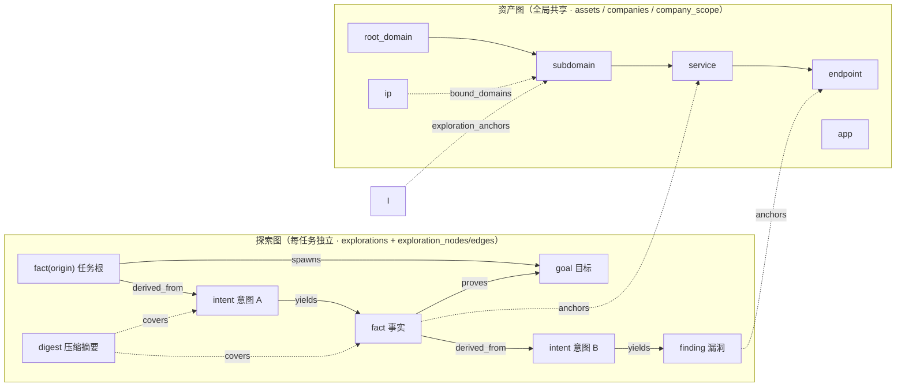
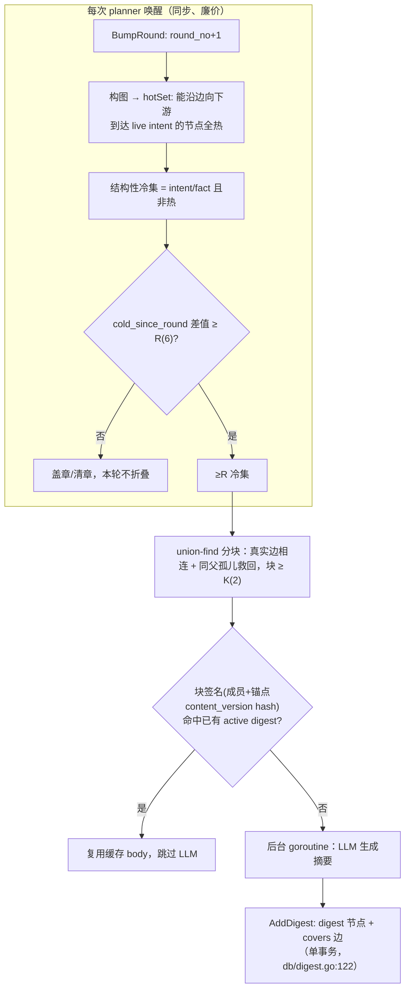

# ARTEX 设计文档 01：双图架构（资产图 + 探索图）

> 重建自 v0.3.15 代码，原设计文档已丢失。本文依据 `db/schema.sql`、`db/assets.go`、`db/exploration.go`、`db/digest.go`、`agent/tools_insert.go` 等实现反推。

**这篇讲什么**：ARTEX 把一次渗透测试所需的全部状态拆成两张相互独立的图——**资产图**（全局共享的"测了什么对象"真值库）与**探索图**（每任务一份的"怎么想、怎么推进"血缘链），再用一张小小的锚点表把两者缝起来。这么设计的动机是：资产是跨任务复用的客观事实，不该随任务结束而丢失；而探索过程（意图、结论、漏洞、提示）是任务私有的推理链，跨任务混在一起只会互相污染。理解这两张图的节点、去重键、状态机和不变量，是读懂 planner/worker 全部行为的前提。

## 一、总体分层与两图分工

分工原则（README「双图架构」节亦然）：**planner 读探索图态势、产出意图；worker 领意图执行、把新资产/事实/漏洞写回两图后即停**。资产图是共享事实，探索图是推进链，两者通过锚点互相可查。

## 二、资产图（全局共享）

### 2.1 六类资产与去重键

`assets` 是单表多型（schema.sql:40-113），`type` 六选一，每种类型由**部分唯一索引**定义去重键（schema.sql:83-91）：

| type | 去重键 | 关键列 |
| --- | --- | --- |
| `root_domain` | `domain` | icp |
| `ip` | `ip` | c_segment / bound_domains / open_ports |
| `subdomain` | `(domain, COALESCE(record_type,''))` | record_value / ip |
| `app` | `bundle_id`，无 bundle_id 则 `app_name` | category / app_description |
| `service` | http: `url`；other: `(domain, ip, port, service_name)` | technologies / auth / page_title / favicon |
| `endpoint` | `(url, method)` | params |

去重键全部由程序计算（归一化、URL 解析、`calcCSegment` 算 /24 或 /48 网段，`db/assets.go:139`），agent 只提交原始信息——`insert_assets` 工具（`agent/tools_insert.go:122`）按 `type` 分发到七个 Upsert 函数。去重冲突时 upsert 语义是"追加合并"：数组类列（technologies / auth / params / record_value / bound_domains / open_ports / task_ids）一律 `unnest(旧 || 新) DISTINCT` 合并，标量列 `COALESCE(EXCLUDED, assets)` 只补空、不覆盖。`service_name` 会 lowercase 归一（`db/assets.go:840`），避免 "SSH" 与 "ssh" 拆成两行。

`assets.ip` 必须是真实地址（`ValidateAssetIP`，`db/assets.go:315`）：网络归属层把该列 `::inet` 参与范围匹配（schema 的 `try_inet` 兜脏数据），主机名写进 ip 会静默失配且无人能察觉，因此在入口直接报错并给出修正指引，让 agent 下一轮自己改。

### 2.2 公司归属与 scope：explicit 与 scope 两级来源

- `companies.nkey` 是归一化的公司唯一名；`company_scope` 五种范围（domain / ip / cidr / icp / keyword，schema.sql:115-148）由 agent 用 `add_company_scope` 录入（`agent/tools_insert.go:377`），其中域名、网络、ICP 会**自动认领**命中的存量资产（`ResolveCompanyWithICP` 在每次 upsert 时调用），keyword 只给 agent 当范围提示。
- `assets.company_source ∈ {explicit, scope}`（schema.sql:49-50）：`explicit` = 人/调用方显式指定，`scope` = 由公司范围规则推导。**所有 upsert 的 company 覆盖 CASE 都遵守同一不变量：显式归属永不被 scope 重算抹掉**（`db/assets.go:289-296` 等各处）。存量库迁移时保守地全部记为 explicit（schema.sql:104-110），这样一次 scope 重建不可能清掉历史手工关联。
- scope 解析与消费其结果的资产写入放在同一事务里串行（`withCompanyScopeMutation`，`db/assets.go:104`），否则并发归属会互相丢更新。

### 2.3 插入副作用：一次提交带出一条主机链

`UpsertSubdomain` 会顺带 upsert 其根域；A/AAAA 记录逐个 upsert 成 `ip` 资产并更新 `bound_domains`（`db/assets.go:476-500`）。`UpsertHTTPService` / `UpsertEndpoint` / `UpsertOtherService` 统一走 `linkHostAssets`（`db/assets.go:939`）：host 也注册为独立的 root_domain + subdomain 资产，IP 顺带记 open_ports。目的：覆盖度分母、资产覆盖图、锚点都必须在这些类型上成立，不能因为 agent 只报了个 URL 就让根域缺席。

### 2.4 任务归属与血缘

- `assets.task_ids BIGINT[]` 是兼容主键关联（GIN 索引查询）；`task_asset_links`（schema.sql:648-663）补记**怎么关联上的**（source=system/agent/legacy/derived + source_node_id 指到具体意图），由 `sync_task_asset_links` 触发器与数组保持同步（schema.sql:667-683）。
- `task_scope`（schema.sql:738-761）是任务的**授权边界 + 覆盖度分母**：worker 顶层显式 `insert_assets` 的资产按保守粒度自动入范围（`AddAutoScope`，`agent/tools_insert.go:364`），side-effect 派生的资产**不**入范围；`add_task_scope` 供 planner/主 agent 主动扩大（根域/公司/ICP）。goals 分解器第 0 轮也会从任务描述里提取范围（`agent/goals.go:53`）。
- 覆盖度 = 范围内资产中，被 fact 节点**锚定**过的占比——分子正是下面锚点表的产物。

## 三、探索图（每任务独立）

### 3.1 七类节点与状态机

`exploration_nodes`（schema.sql:170-246）每任务一份，`kind` 七选一、`state` 受按 kind 区分的 CHECK 约束（`db/constants.go:4-40` 定义常量）：

- **begin**（已废弃）：旧任务根；新任务改为播种一个 `kind='fact', state='origin'` 的根事实（`StateOrigin`，`db/constants.go:26`），使"每个意图必连到 fact"从第一条意图起就成立。
- **goal**：`open → met | abandoned`。planner 用 `prove_goal` 逐个证明，最后一个 met 触发任务完成。
- **intent**：`open → running → done | blocked | exhausted | stopped | paused | deleted`。详见 02 篇；`deleted` 是假删除（保留节点与全部血缘，`delete_reason` 记原因，`db/exploration.go:389`）。
- **fact**：`confirmed | dismissed | origin`。worker 的探索结论（含否定结论），一意图通常一条汇总。
- **finding**：`confirmed | dismissed`，与 findings 表双向关联（node_id FK + `FindingIntents` 反查）。
- **hint**：`active | consumed`，人/编排器下发的战略提示。
- **digest**：`active | superseded`，冷节点压缩产物（见第五节）。

### 3.2 五种边与血缘不变量

`exploration_edges`（schema.sql:248-274），主键 `(exploration_id, src_id, rel, dst_id)` 即幂等，`rel` 五选一：

- `spawns`：goal → intent（目标派生方向）
- `derived_from`：fact/finding → intent（**多个事实综合出一个新意图**；planner 的 add_intent 强制 parent 只能是 fact/finding，顶层方向兜底连 origin fact，`agent/tools.go:1032-1088`）
- `yields`：intent → fact/finding（意图产出结论）
- `proves`：fact → goal（证明目标达成）
- `covers`：digest → 成员（压缩视图专用，算法构图时**刻意过滤**以免污染因果可达性，`agent/coldgraph.go:66`）

维护者必须守住的不变量：**每条 intent 都能沿 derived_from/spawns 回溯到某个 fact**；`CancelIntent` 的"独占级联删除"（`db/exploration.go:434`）正是按这条可达性算的——只有全部父节点都落在删除集内的下游才跟着删，goal 与 origin fact 永不删，被其他分支引用的共享节点保留。被删意图先做 token rollup（`intentTokenRollup`，`db/exploration.go:609`）保留不可逆计量。

### 3.3 activity 过程流水

`activity`（schema.sql:298-339）记录每个 worker/planner 的每一步（tool_use/tool_result/thinking/text/result…），是 worker 间信息交换和 UI 会话页的数据源。两条工程要点：工具输出可能携带非法 UTF-8 / NUL 字节，入库前必须过 `utf8Clean` / `jsonbClean`（`db/exploration.go:28-64`），否则整条 INSERT 静默失败；`kind='result'` 终结行携带 token 四元组，全任务/全 worker/按会话的统计都只从 result 行聚合（`TokenStatsBySession`，`db/exploration.go:1445`），不存在双重计数。`main_sessions`（schema.sql:346-351）支持主 agent「新建会话」分段重置对话而不动图。

## 四、锚点：两图之间的桥

`exploration_anchors(node_id, asset_id)`（schema.sql:276-281，多对多、幂等）：把 intent/fact/finding 锚到具体资产。它回答两个问题——"这条探索方向打的是哪些资产"（`graphOverview`）与"这个资产在本任务被哪些意图测过、得出过哪些结论"（`AssetRefs`，`db/exploration.go:1892`），同时是覆盖度分子和任务删除时"哪些主机流量可安全清掉"的判定输入（`hostsForTaskDeletion`，`db/assets.go:1285`）。

设计要点：**锚点已不再做可见性闸门**（`db/exploration.go:250` 注释）——任何任务都可经 search 读任意资产，锚点只保留推理谱系。写锚点有三个来源：planner `add_intent` 传 asset_ids、worker `record_fact`/`report_finding` 附带、`insert_assets` 落库后 `anchorOwner(id)` 回写（`agent/tools_insert.go:342`）。

## 五、冷节点压缩（cold-digest）

探索图会随任务推进无限增长，而 planner 每轮唤醒都要读全图态势。cold-digest 是一套**无损**压缩：把持续无下游分支的 intent/fact 折叠成 digest 摘要节点，成员保留、可随时按 id 展开（主 agent 的 `expandDigest` 工具）。

关键机制与不变量：

- **debounce 按"本轮数"计**：`explorations.round_no` 每次 planner 唤醒 +1（`db/digest.go:17`）；节点从"有活分支"变"无活分支"那一刻盖 `cold_since_round`（`db/digest.go:33-86`），**重新变热即清章**，从不重盖——保证"冷了多久"度量的方向正确。阈值 R=6、K=2（`agent/coldgraph.go:45`）。
- **热集规则**：能沿边向下游到达 open/running/paused 意图的节点全热（活分支的整条上游链不折叠），活意图刚产出的直接子 fact 也热（`agent/coldgraph.go:105`）。finding/goal/hint/begin 永不折叠。
- **变更检测**：`content_version` 在任何会改变摘要内容的写（SetNodeState / SetIntentState / SoftDeleteIntent）时自增（`db/exploration.go:269/356`）；块签名 = 排序后的成员 id+版本与锚点 id+版本的 SHA-256（`agent/coldgraph.go:285`），同签名重压缩直接复用旧 body，不烧 LLM。
- **一致性**：`AddDigest` 把 digest 节点与 covers 边写在一个事务里；`SupersedeDigests` 退役时**同时**删 covers 边（`db/digest.go:201`），`CoveredMembers` 只统计 active digest、重复覆盖取最小 digest id（`db/digest.go:153`），因此不会出现"成员被两个摘要重复计入"的撕裂读。LLM 压缩跑在 detached goroutine，绝不给规划轮加延迟。

## 六、schema 幂等迁移设计

`db/schema.sql` 由 `go:embed` 打进二进制，**每次启动全文 Exec 一遍**，所有迁移因此必须幂等。约定（全文贯穿）：

- 建表/建索引一律 `IF NOT EXISTS`；函数 `OR REPLACE`；触发器先 `DROP TRIGGER IF EXISTS` 再建。
- 补列一律 `ADD COLUMN IF NOT EXISTS`，默认值选"旧库行为不变"（如 `streaming DEFAULT true`、`max_tokens DEFAULT 0`）。
- **放宽 CHECK 不能靠 ADD CONSTRAINT**（会重名失败）：统一"先 `DROP CONSTRAINT IF EXISTS` 再加"，或用 `DO $$` 块查 `pg_constraint` 定义、仅当旧定义缺少新枚举值时才重建（`ck_node_kind` 补 digest、`ck_node_state` 补 paused/superseded/deleted、`ck_edge_rel` 补 covers，schema.sql:204-274）。
- **一次性数据迁移必须带存在性哨兵**：schema 每次启动都跑，普通 UPDATE 会每次覆盖用户手改。`thinking_type` 从 `reasoning_effort` 的拆分迁移（schema.sql:462-474）以"该列尚不存在"为哨兵，只跑一次；旧 `llm_profile_id` 回填任务链用 `NOT EXISTS + ON CONFLICT DO NOTHING`（schema.sql:720-730）。
- 种子数据一律 `ON CONFLICT DO NOTHING`（如 ScopeSentry MCP 占位，schema.sql:860-862），绝不覆盖用户配置。
- 找不到的约束（存量库内联自动命名）用定义内容模糊匹配定位（`DO $$ ... pg_get_constraintdef ... NOT LIKE '%covers%'`）。

维护者加迁移时的底线：新库与十年老库跑同一份文件都必须得到相同终态，且不能在第二次启动时抹掉用户运行期写入。

## 七、不变量清单（改代码前先对照）

1. `assets.ip` 只存真实地址；主机名走 subdomain（`ValidateAssetIP`）。
2. `company_source='explicit'` 的归属永不被 scope upsert 覆盖。
3. scope 解析与其消费在同一事务（`withCompanyScopeMutation`）。
4. 每条 intent 沿血缘可回溯到 fact（add_intent 入口强制）。
5. 意图状态迁移走 CAS（`CompareAndSetIntentState`）；终态迁移全部集中在 engine 一处（见 02 篇）。
6. 锚点只记谱系，不做权限；资产可见性由 task_scope 过滤。
7. token 计量只从 `activity.kind='result'` 聚合；意图取消先 rollup 再删行。
8. digest 的 covers 边与 digest 状态同事务增删；覆盖判定只认 active digest。
9. schema.sql 幂等：任何新迁移在重复执行下无副作用、不覆盖用户数据。
