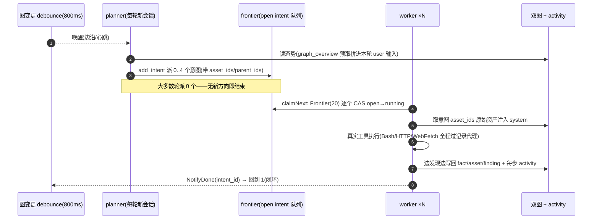
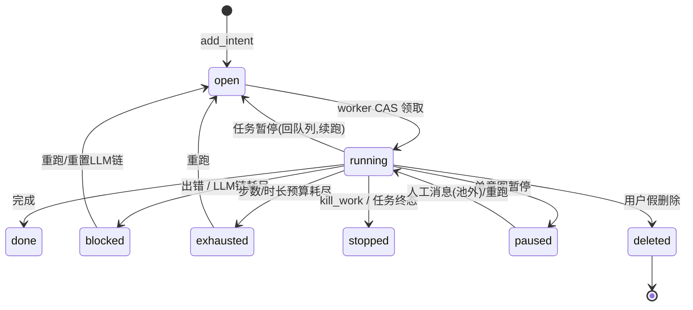
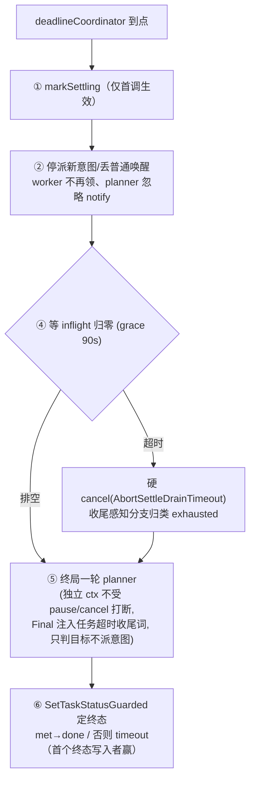

# ARTEX 设计文档 02：引擎与调度闭环

> 重建自 v0.3.15 代码，原设计文档已丢失。本文依据 `server/engine.go`、`server/engine_timeout.go`、`server/manager.go`、`server/goals.go`、`agent/planner.go`、`agent/worker.go`、`agent/goals.go` 等实现反推。

**这篇讲什么**：引擎是事件驱动的闭环——图一变就唤醒 planner，planner 派意图进 frontier，worker 领意图执行并写回，写回又触发下一轮，直到目标被逐个证明或预算/超时收场。这样设计的原因是渗透测试的推进节奏天然不均匀：一个方向可能秒级出结论，一条利用链可能要等前置事实；轮询式调度要么烧钱空转、要么响应迟钝。本篇覆盖唤醒机制、planner/worker 的职责边界与不变量、意图状态机的全部出路、暂停/取消/删除/超时的每一种收场，以及 worker 之间"以执行过程为粒度"的信息交换。

## 一、事件驱动唤醒：notify + debounce + 心跳

每任务一个 `Task`（`server/manager.go:29`），持有一个容量 1 的 `notify` channel。所有图变更入口（worker 完成、finding 上报、人补目标/提示/删意图等）都调 `t.Notify()`（非阻塞，`server/manager.go:1751`），并按事件类型往 `pendingTriggers` 里记一条结构化事件（`NotifyDone/NotifyFinding/NotifyGoal/NotifyHint/NotifyCancelled/NotifyGoalDeleted/NotifyGoalEdited`，`server/manager.go:1762-1851`）。

planner 循环（`server/engine.go:800`）在两种信号上唤醒：

- **边沿**：`t.notify` 触发 `runRound("edge")`；
- **心跳**：`heartbeat` 定时器按 `plan_heartbeat_seconds` 触发 `runRound("heartbeat")`——兜死锁、顺带巡查在跑意图（长时间无进展 `steer_work` 纠偏、方向整个错 `kill_work` 止损），下限 600s（`db/tasks.go:83`）。

`runRound` 先做 **debounce（800ms，`NewEngine` 默认）**：把一次爆发里的多个 notify 合并成一轮规划；然后依次过闸：planner 未就绪 → 直接返回（LLM 配置好后自动恢复）、paused / deleting / 终态 / settling / goalless（无 open goal 时是否结束改由 frontier 抽干决定，`server/engine.go:845-858`）→ 都过了才 `beginTaskOperation` 计入在跑数、真正调 `planner.Plan`。



**首轮触发去重**（`server/engine.go:772-776`）：带种子意图的任务，种子可能刚被 worker 抢先领成 running——所以判定用 `HasActiveIntent()`（open **或** running，`db/exploration.go:1155`），而不是只数 open；否则会与 worker 领取竞态、误触发一轮多余规划。

## 二、任务启动：launchTask → 目标拆解 → engine.Run

所有创建路径（HTTP createTask、编排 spawn_task）共用 `launchTask`（`server/goals.go:28`）：seed 根资产 →（可选）种子意图 → `admitTask(bootstrap)`。`admitTask` 是**唯一准入路径**（`server/goals.go:99`）：开启并发上限时，达到上限/LLM 未就绪/有更早排队者 → 持久 FIFO 排队（`queued_at` 纳秒序保证同秒创建也 FIFO）；否则 `startAdmittedTask` 先跑**第 0 轮目标拆解**（`startTaskEngine`，`server/goals.go:42`）——`DecomposeGoalsWithProvider`（`agent/goals.go:110`）用 LLM 把目标文本拆成可核验的 goal 节点（set_goals 直接落库），同时抽操作约束（set_constraints）和测试范围（add_task_scope），**拆完才 engine.Run**，避免 planner 抢在 goal 之前跑的竞态。

LLM 未就绪时任务也能创建：循环照起、空转直到配置可用；终态/暂停任务恢复走 `admitTask(resume)`，排队中的 bootstrap 模式会被保留（`queue_mode`），恢复后仍补拆解。

## 三、planner：唯一意图生成者 + 跨唤醒共享 todolist

planner 是**系统中唯一合法的意图生成者**（`agent/planner.go:23`），且每次唤醒是**全新会话**——没有记忆。两个机制让它在无状态会话上稳定推进：

1. **态势预取**：`graph_overview` 的返回直接拼进本轮 user 输入（`renderGraphOverview`，`agent/planner.go:287`），触发事件（哪个意图结束、输出了什么结论、产出了哪些 fact id；谁报了 finding；人加了什么）拼在最前面（`renderTriggers`，`agent/planner.go:173`）。system prompt 只留静态规划正文——**每轮稳定、利于提示缓存**。
2. **跨唤醒共享 todolist**（`Planner.todoFor`，`agent/planner.go:108`）：每个 exploration 一份 `TodoStore`，跨唤醒常驻。串行利用链（注入点→凭据→横向→提权）记录一次，之后每轮只对"前置已完成、依赖的 fact 已存在"的那一步派意图，并用 TodoWrite 更新清单——避免一次性并行派发导致下游拿不到还不存在的前置而空转重复。

planner 的产出纪律写死在提示里（`agent/planner.go:298`）：**硬底线**——目标未达成且无任何 open/running 意图时必须产出至少一个意图（否则任务停摆）；其余情况派 0 个是正常结果但要有理由（已覆盖 / 等待依赖）。去重主要靠 summary 与 open+running+recent_done 比对；done 的意图只有出现"材料性新机理"才重派；exhausted/blocked 先看 trace 实际做到哪再决定续派/重派/换打法。单轮最多 4 个意图、一次 `add_intent` 批量提交。

**目标判定**也是 planner 的核心职责：逐个 `prove_goal(goal_id, evidence_id)`；量化验收（覆盖率、flag 数）必须核对实测值，严禁提前盖章。最后一个 goal met 时引擎 `SetTaskStatus("done")` 并 `cancelExec(AbortGoalMet)` 取消在跑 worker（`server/engine.go:886-894`）。

## 四、frontier 意图队列与 worker 领取

frontier 就是 `exploration_nodes` 里 `kind='intent' AND state='open'` 的行，按 `priority DESC, id ASC`（同优先级 FIFO）排序（`Frontier`，`db/exploration.go:1136`；部分索引 idx_expnodes_frontier 支撑）。worker 循环（`server/engine.go:916`）：

```
循环：paused/settling/终态 → 睡 1s 继续
  → claimNext: Frontier(20) 逐个尝试 ClaimIntent(CAS open→running, owner=work#N)
  → 领到 → runWorkerStep → runIntent
  → 没领到 → sleep 800ms 再来
```

CAS 领取保证**一条意图同时至多一个 worker**；重启后遗留的 running 意图由 `ResetRunningIntents` 批量放回 open（`db/exploration.go:312`，worker 会从 transcript 续跑，重开是安全的）。人给 paused 意图发消息走 `runDetachedIntent`（`server/engine.go:1171`）：在池外独立 goroutine 里 **CAS paused→running** 直接续跑（不经过 open，池子抢不到），不占池槽位、立即响应用户。

## 五、worker 执行与写回：做完即停

worker 领**一条**意图，完成它、把发现写回两图、然后停止（`agent/worker.go:23`）。三个职责边界写进 system prompt：不生成新方向（线索写进 fact summary 交给规划者）、不做别的意图、写回才算数。意图本身**放在 system prompt**（连同启动指令、锚定资产原始数据，`agent/worker.go:384-420`）——system 每次 run 重拼、绝不会被上下文压缩掉，长 run 里意图永远在场；全局态势 overview 降级放 user 消息（可容忍 stale）。

写回三件套（`tsx.WorkerTools()`，`agent/tools_insert.go:644`）：
- `insert_assets` → 资产图（带资产拦截闸门，见 04 篇）；
- `record_fact` → 探索图（**一意图一条汇总**，带 evidence/confidence，否定结论也记）；
- `report_finding` → 探索图 + findings 表（须真实触发拿到 PoC，指纹匹配不算）。

每步执行经 `emitActivity` 落 activity（存储与 SSE 广播单点分发，`server/engine.go:640`），写入失败重试 3 次，仍失败**显式记日志**（含 FK 现场诊断 `ExplorationDiag`），不再静默丢弃。finding 落库即唤醒 planner（`NotifyFinding` 带 finding 上下文中途唤醒）。

## 六、意图状态机的所有出路

`runIntent`（`server/engine.go:982`）是唯一的执行+结算点（池路径与人工消息路径共用）。终态分流按序判定，**全部走 CAS**（`CompareAndSetIntentState`，`db/exploration.go:363`）防止陈旧覆盖：

| 情形 | 终态 | 说明 |
| --- | --- | --- |
| 正常完成 | `done` | worker 返回 ReasonCompleted |
| 执行出错（非额度类） | `blocked` | LLM/网络故障基本没探成 |
| 撞步数上限 / 运行超时 | `exhausted` | 探到一半被掐断，只写回部分——规划者据此知道该换角度而非当已覆盖跳过 |
| LLM 链耗尽 | `blocked` + blocked_reason=`llm_quota_exhausted` | 用户保存/重置链后 `ReopenIntentsByBlockedReason` 批量重开 |
| 任务暂停 | **回 open**（非终态） | resume 后重新领取，worker 从 transcript 续跑 |
| 收尾期硬 cancel | `exhausted` | 超时收尾，别误标 blocked |
| 任务已终态 | `stopped` | 完成后取消的收尾 run |
| planner kill_work / 用户取消单意图 | `stopped`（取消会先 park 成 paused 等清理） | 不写回、不自动重领 |
| work 级 pause / 用户暂停单意图 | `paused` | `ControlWork` 等待 worker 完全停写后返回 |
| 用户假删除（任意前置状态） | `deleted` + delete_reason | 保留节点与血缘（SoftDeleteIntent） |
| 用户真删除 | 物理删除 | CancelIntent 独占级联 |

结束一律 `NotifyDone(intent_id)` 唤醒 planner。**model_error 收场的意图额外重跑**至多 2 次、间隔 3s（`server/engine.go:71-75`），给 provider 恢复时间——但仅在意图仍属本 work、任务未暂停/终止/收尾时；配额错误已推进任务 LLM 游标的**不**重跑（避免在备用模型上重放整个意图产生重复副作用）。



## 七、暂停 / 恢复 / 取消 / 删除

- **任务暂停**：`Engine.Pause` 置 paused 并 `cancelExec`（取消在跑 planner/worker 的 exec ctx，`server/engine.go:178`）。在跑 worker 检测到 pause 因果 → 意图回 open；`execContextFor` 在 paused 期间发出去的都是**预取消**的 ctx（防领取→执行竞态，`server/engine.go:324`）。Resume 清 paused 并 Notify 一轮新规划。
- **单意图控制**：`ControlWork`（pause/cancel，`server/engine.go:427`）注册 `workExecution{cancel, done}`，等 `detachWork` 的 done 信号确认 worker 已停写后才返回，避免与意图删除清理竞态。取消路径先把意图 park 成 paused，再由 API 侧做取消清理——HTTP 断连也不会留下幽灵 running 行。
- **planner 纠偏/止损**：`SteerWork` 把消息入队（`steerBox`），worker 的 `steerHooks.PreToolUse` 在下一次工具调用前排空并**阻塞该调用**、把消息作为反馈回灌模型重新规划——不杀进程（`server/engine.go:493/531`）。
- **删除**：`BeginDelete` 原子装屏障（deleteMu 下 paused + deleting），已准入 writer 全部反映在 inflight、后来者被拒；数据清理后 `StopTask` cancel 任务级 runtime ctx、等所有 goroutine 退出、逐项清内存状态（`server/engine.go:187/247`）。

## 八、任务级超时收尾时序

带 `timeout_seconds` 的任务用**绝对墙钟**：首次真正运行时 `stampFirstRun` 盖 `first_run_at/deadline_at`（`server/engine_timeout.go:96`，进程内只盖一次）。此后：



run 级与任务级墙钟用 `clampMaxDuration` 夹逼（`agent/taskclock.go`）：worker 的 MaxDuration 取 min(自身预算, 距 deadline 剩余)，到点由 SDK 打断在跑工具并就地进收尾（`Settlement` 提示先把已识别的写回再一句话总结，`agent/worker.go:154`）——烂尾不丢事实。超时→running 的复活路径由 `resetTimeoutRevival` 清干净旧状态（`server/engine_timeout.go:87`）。

## 九、worker 间过程级信息交换

有价值的观察常出现在一个 worker 的**执行过程**里而没写成正式 fact。为此 worker 拥有跨 work 检索能力（`tsx.WorkerTools()`，`agent/tools_insert.go:653`）：

- `search_all_worker_traces(q)`：在本任务**其他** work 的 activity 里按关键字检索（`ActivityTraceSearchExcluding` 自动排除自己这条意图的步骤，`db/exploration.go:1930`），命中项带 intent_id；
- `get_worker_trace(intent_id, [step_ids])`：锁定某条 work，列步骤摘要或按 id 取**完整 detail**（`ActivityByIDs`）；
- `node_detail(id)`：拿到节点 id 后查完整详情。

信息在 worker 之间以"执行过程"为粒度流动，而边界不变——每个 worker 仍只做领到的那条意图。**读取边界有专门的终态保护**：继承场景（关联任务）的 trace 读取都带 `ForTerminalIntent` 变体，把"意图处于终态"的判定和行读取放进同一条 SQL（`db/exploration.go:1517/1638/1790`），源任务重开意图的瞬间不会泄露新在跑的轨迹；thinking/usage 行永远不外露。

## 十、空转回合续跑

模型只输出思考、既无正文也无工具调用的回合，harness 会当自然结束收场——一条没做完的意图就此断在半路。`steerHooks.Stop` 检测到 thinking-only 回合时注入一条续跑指令（带着已有思考继续，而不是原样重发 prompt 让它再想一遍），上限 `defaultEmptyTurnNudges=2`（`server/engine.go:531-620`）。注意这个额度是**每条意图总量**、建在 model_error 重跑循环之外（重跑不清零）；harness 自身的 stopHookActive 已限死"连续空转只推一次"，这个闸挡的是"工具→空转→推→工具→空转"的病态循环耗光预算。

## 十一、维护者速查

| 改动点 | 位置 |
| --- | --- |
| 加一种规划触发事件 | `manager.go` Notify* + `planner.go` TriggerEvent/renderTriggers |
| 加一种意图终态 | schema `ck_node_state` + engine `runIntent` 分流 + planner 提示的 state 语义 |
| 改唤醒节奏 | `NewEngine` debounce / `plan_heartbeat_seconds` |
| 改超时时序 | `engine_timeout.go` 常量 + `settleTask` |
| 加 worker 工具 | `tools*.go` + `WorkerTools()`（同时核对拦截工具白名单默认集） |
