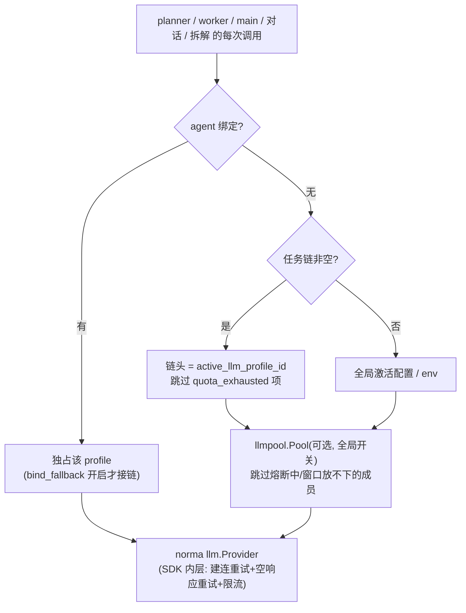
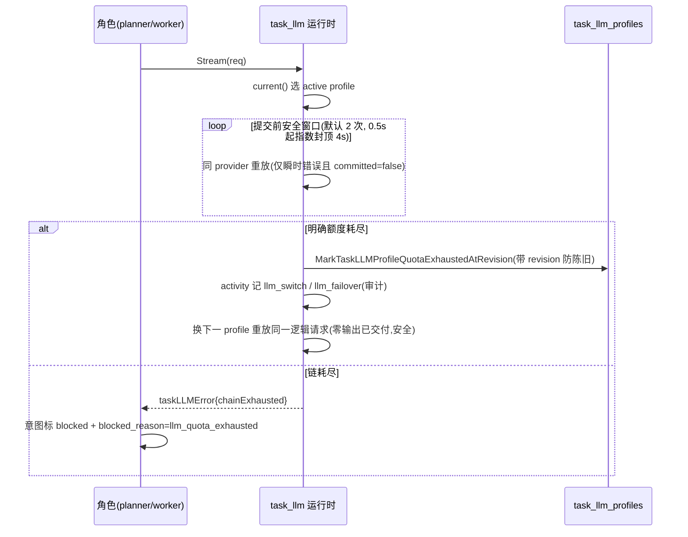

# ARTEX 设计文档 03：LLM 接入层

> 重建自 v0.3.15 代码，原设计文档已丢失。本文依据 `llmpool/`、`llmrec/`、`server/task_llm.go`、`server/llmpool.go`、`agent/provider.go`、`db/llmretry.go`、`db/llmhealth.go`、`db/llm_usage.go` 等实现反推。

**这篇讲什么**：整个系统（planner/worker/主 agent/对话/目标拆解/兜底裁判）共用一条"配置解析 → 重试 → 熔断 → 故障转移 → 录制 → 计量"的 LLM 接入管线。这么分层的原因是：渗透测试动辄数千次模型调用，余额耗尽、密钥失效、限流、网关抖动是常态而非异常；且一次会话中途切换模型绝不能重复产出（否则对话历史损坏、工具副作用翻倍）。本篇讲清三层选路优先级、两级熔断的判定口径、"提交前安全窗口"这一核心安全不变量，以及五层重试与 token 计量的归属规则。

## 一、三层选路优先级

每次真实调用由 `taskLLMRuntime.current()` 解析（`server/task_llm.go:110`），优先级固定：

1. **agent 绑定**（`agents.llm_profile_id`）：某角色被显式指定模型就一直跑在它上面——默认**独占**，失败即失败；仅当 `llm_pool_bind_fallback` 开启才回落到链（`poolForBinding`，`server/llmpool.go:147`）。
2. **任务 LLM 配置链**（`task_llm_profiles`，schema.sql:696-730）：任务建链后按 `position` 有序；每项有 `ready | quota_exhausted` 状态，**额度耗尽项被跳过直到用户保存/重置链**（重置同时清全部失败状态，`ReplaceTaskLLMProfiles`，`server/manager.go:1050`）。链头是 `active_llm_profile_id`。
3. **全局配置**：库里的激活配置，或环境变量（`FromEnv`，`agent/provider.go:145`）兜底。

解析失败分层处理：任务链存在但全耗尽 → 返回 `taskLLMError{chainExhausted}` 硬停（**绝不静默回落全局**，`SetAuthoritativeAgentResolver` 专门保证这一点，`server/engine.go:713`）—— exhausted 链上的任务悄悄用全局 key 继续跑，既烧别人的钱也违背了用户建链的意图。

## 二、有序故障转移链（llmpool）

`llmpool.Pool` 实现 `llm.Provider` 接口、包住一条有序成员链（`llmpool/pool.go:82`）。链的构建在 server 侧（`poolChain`，`server/llmpool.go:80`）：**链头永远是当前生效配置**（全局激活或绑定项，Rank=`RankActive` 压过一切用户优先级），其后按 `priority DESC`，`pool_exclude=true` 的配置不进链。同一 rank 的成员**轮流领头**（`rotateGroups`，`pool.go:189`）——同优先级多配一份即天然负载分担。

每次调用前 `order()` 过滤：跳过熔断冷却中的成员、跳过上下文窗口装不下本请求的成员（粗估 ~3.5 字符/token，宁可高估，`estimateTokens`，`pool.go:274`）；**全被滤光时仍试探链头**——卡死引擎比再失败一次更糟（`pool.go:181`）。

**唯一硬规则（本模块的灵魂）**：成员只有在**尚未向调用方交付任何事件**前才允许被放弃（`pool.go:79-82`）。一旦 text/tool_use 已 yield 出去，换模型重发会重复输出、污染会话历史，所以流中段失败原样上抛，交给 harness 的续跑逻辑处理。幸运的是，这套机制要对付的故障（402 余额、401 密钥、429、5xx）都在建连阶段暴露，天然落在安全窗口内。

故障转移的判定口径（`shouldFailover`，`pool.go:231`）：
- **绝不**因 ctx 取消转移——那是用户停任务/任务超时，烧备用 key 既浪费也污染终态诊断；
- **绝不**因 400 转移——请求本身有问题，到哪都一样；
- 401/402/403/404/408/429 与 5xx 转移；无状态码（连接重置/DNS/超时）转移。

## 三、两级熔断与退避阶梯

`llmpool.Registry`（`llmpool/health.go:44`）是**进程级共享**的熔断注册表——重建 Pool（改个无关配置）不清空已知结论：某任务发现某配置欠费，其他任务立刻跳过它。两级判定（`Trip`，`health.go:138`）：

- **确定性失败**（`isHardFailure`：401/402/403/404，即欠费/密钥失效/模型不存在）→ **首次即熔断**。这类故障人不去修不会好，连续计数毫无意义。
- **软失败**（429/5xx/网络）→ 连续 `softTripAfter=3` 次才熔断（可配，负值=永不软熔断）。
- 冷却走阶梯：第 1 次熔断冷却 1 分钟、第 2 次 5 分钟、之后每次 30 分钟（`backoff`，`health.go:21`；可配固定值）。`Pass` 成功即清零并删库行。

内存态为准，`llm_profile_health` 表只为**重启不丢冷却窗口**（`newLLMHealthRegistry`，`server/llmpool.go:22`）：加载时只取 `open_until > now()` 的行——重启期间冷却到期的配置自然回到健康，下次调用半开试探。写入异步 best-effort，UI 可手动「立即恢复」（`Reset` → `ClearLLMHealth`）。

## 四、任务级额度故障转移（task_llm）与提交前安全窗口

全局链之上还有一层**任务链专属**的故障转移（`streamTaskLLM`/`completeTaskLLM`，`server/task_llm.go:287/237`），它只处理一件事：**明确表述余额/额度耗尽的错误**。判定刻意收窄（`IsQuotaExhaustedMessage`，`agent/provider.go:292`）：普通 429、限流文案（"quota metric"/"rate limit"/rpm/tpm）、401/403/5xx 一律**不**触发轮换——供应商把普通限流说成 "quota exceeded" 太常见，只有 `insufficient_quota`、`billing_hard_limit`、`credit balance`、`余额不足` 这类硬性表述（且不含限流措辞、不含 401/5xx 状态）才算数。

流转时序：

`committed` 的定义在 `streamEventCommitOutput`（`task_llm.go:386`）：出现过 text delta / thinking delta / tool_input JSON / message 边界事件即算交付。commit 前任何可重试失败可原样重放；commit 后只上抛。**额度耗尽属例外**：即便已 commit，也要先把该 profile 标耗尽（链推进是不可逆的簿记），但错误包装成**非** chainExhausted 的 `taskLLMError`，worker 侧据此**不**在备用模型上重放整条意图（`isTaskLLMRouterError` 把它从 model_error 重跑中剔除，`server/engine.go:82`）——部分流式输出已驱动过工具执行，重放会重复副作用。

链状态变更（revision 防陈旧：用户中途改链，旧的推进结果作废）会发 activity 审计行（`emitTaskLLMTransition`，`task_llm.go:618`），kind=`llm_switch`（自动切换）/`llm_failover`（链耗尽）/`llm_switch`+mode=manual（用户手动切）。

## 五、五层重试

同一瞬时故障有五道独立防线，各自独立配置（`RetryRule` 语义统一：次数 0=内置默认、-1=关闭、>0=定制；间隔 0=指数退避、>0=固定毫秒，`db/llmretry.go:20`；解析优先级 profile 覆盖 → 全局策略 `llm_retry_policy` → 内置默认，`sameProviderRetryPolicy`，`task_llm.go:414`）：

| 层 | 作用范围 | 内置默认 | 实现 |
| --- | --- | --- | --- |
| connect（建连） | SDK 内，流开始前（重置/超时/429/5xx） | 3 次，指数封顶 8s | `llm.Config.MaxRetries` |
| empty（空响应） | SDK 内，完成但零 content block（仅 openai 格式） | 2 次 | `llm.Config.EmptyResponseRetries` |
| stream（同 provider 安全窗口） | 本项目，未交付输出前的断流/过载/流内 429 | 2 次，0.5s 起指数封顶 4s | `streamTaskLLM` 重放循环 |
| breaker（熔断冷却） | llmpool，跨请求 | 3 次软熔断 + 1/5/30min | `llmpool.Registry` |
| intent（意图重跑） | engine，model_error 收场后整条意图 | 2 次，固定 3s | `runIntent` 重试循环 |

分层原因：SDK 只能管到"拿到 200 之前"，流一旦开始的中途断流它零重试；而 stream 层补上后，`isRetryableStreamError`（`task_llm.go:431`）排除了额度（交给链）、上下文超长（交给 harness 压缩）、确定性 4xx——**可重试的判据是"同类失败重放有意义"**。

## 六、请求录制装饰器（llmrec）

`llmrec.Recorder` 包在每个 provider 外层（`llmrec/llmrec.go:118`），每次调用写两行：

- **轻量计量行**（`llm_usage` 表）：**始终写、不受录制开关控制**——它驱动配置页的 token 统计，必须覆盖失败/中断的调用才算得准（`recordUsage`，`llmrec.go:267`）。
- **重迹行**（`llm_records` 表，含完整请求/响应）：由 `llm_record` 设置开关。归一化视图之外还带**原始 wire 报文**：`llmrec.Capture` 挂在 ctx 上，由 `quotaAwareTransport`（真正看得到字节的那一层）填入——norma 内部自己 build body、自己解 SSE，Recorder 看到的已是解码后的视图，调试线上网关只有 wire 字节是 ground truth。norma 的建连重试意味着一次 Stream 可能发出多个 HTTP 尝试，每次尝试的状态码与 body 都分别保留（被丢弃的尝试恰是诊断限流/网关故障的关键，`llmrec/capture.go:23`）。

use 的折算细节：Anthropic 系把 token 拆在两个事件里——`message_start` 只带输入侧、`message_delta` 只带输出侧，必须用 `Usage.Add` 折叠，直接覆盖会把输入清零（`llmrec.go:189-209`）。

Recorder 按 profile 各包一层，因此**失败尝试也归属在它自己的 profile 名下**（`server/llmpool.go:60` 的注释）。

## 七、会话头 / 代理 / 429→402 归一化

- **会话头**：`session_header_key` 非空时每个请求带一个自定义 HTTP 头，头值 = 当前会话 id（从 ctx 上读 `transcript.SessionIDFrom`，`agent/provider.go:338-347`）。服务的是按 session-id 做提示缓存/粘性路由的网关（如 opencode zen 缺此头直接 400）。同一共享 provider 也能按会话发不同头值，因为值挂在请求 ctx 而非 provider 上。
- **代理**：`proxy` 支持 http/https/socks5；**空 = 直连且不回退 *_PROXY 环境变量**（`agent/provider.go:400-419`，显式置 `transport.Proxy=nil`）——LLM 出口是用户明确配置的边界，不该被环境变量意外改道。这和目标流量的全局出口代理（`m.ProxyAddr`）是两条独立的链路。
- **429→402 归一化**：`quotaAwareTransport` 拦截 429 响应，body 命中 `IsQuotaExhaustedMessage` 时把状态码改写成 402 再返回（`agent/provider.go:364-379`）。原因：SDK 的重试循环把所有 429 当瞬时；不归一化的话欠费配置会被空转重试烧完才轮换，改写后任务路由立刻转移，同时保留原始 body 供分类与审计。tee 而非读：200 是必须继续流式输送的 SSE，429 分支读的 body 经 tee 落进 Capture。

## 八、token 计量归属

归属靠三层信息拼起来：

1. **会话 id 解析**（`parseSession`，`llmrec.go:90`）：`exp<N>-planner` / `exp<N>-worker-i<意图>` / `exp<N>-goals` / `conv-<id>`……exploration id 与角色都在里面。任务注册 id 由 task runtime 显式 `llmrec.WithTaskID` 挂 ctx（与解析出的 id 不同名时以显式为准）。
2. **Lane 覆盖**：不走标准会话的调用（兜底裁判）用 `llmrec.WithWorker(ctx, "judge")` 显式改 lane，使配置页能把裁判消耗单独列出（`server/intercept.go:51`）。
3. **两套账本**：`llm_usage`（每次调用一行，按 profile/lane/model 聚合，配置页视图）与 `activity.kind='result'`（每次 run 一行，任务页视图）。任务侧统计按**意图**而非 work#N 聚合（`TokenStatsBySession`，`db/exploration.go:1445`）——worker 槽位可复用，重试/重派必须归到同一行。

## 九、维护者注意事项

- 新增一条 LLM 调用路径（新 agent/新裁判）时：必须走同一 `llm.Provider` 解析链（共享限流/熔断/录制），而不是绕开自建 HTTP——目标拆解当年就是为了这个才把 provider 改成调用方注入的（`agent/goals.go:81` 注释）。
- 判定"该不该转移/重试"时先问：**这次失败重放到另一个模型上，会不会重复产出或重复副作用？** 会 → 只能上抛；不会 → 才允许换。这是贯穿五层的一致判据。
- 改配额判定文案（`IsQuotaExhaustedMessage`）务必保持"收窄"倾向：误把限流当欠费会无意义轮换并烧光链上所有 key。
