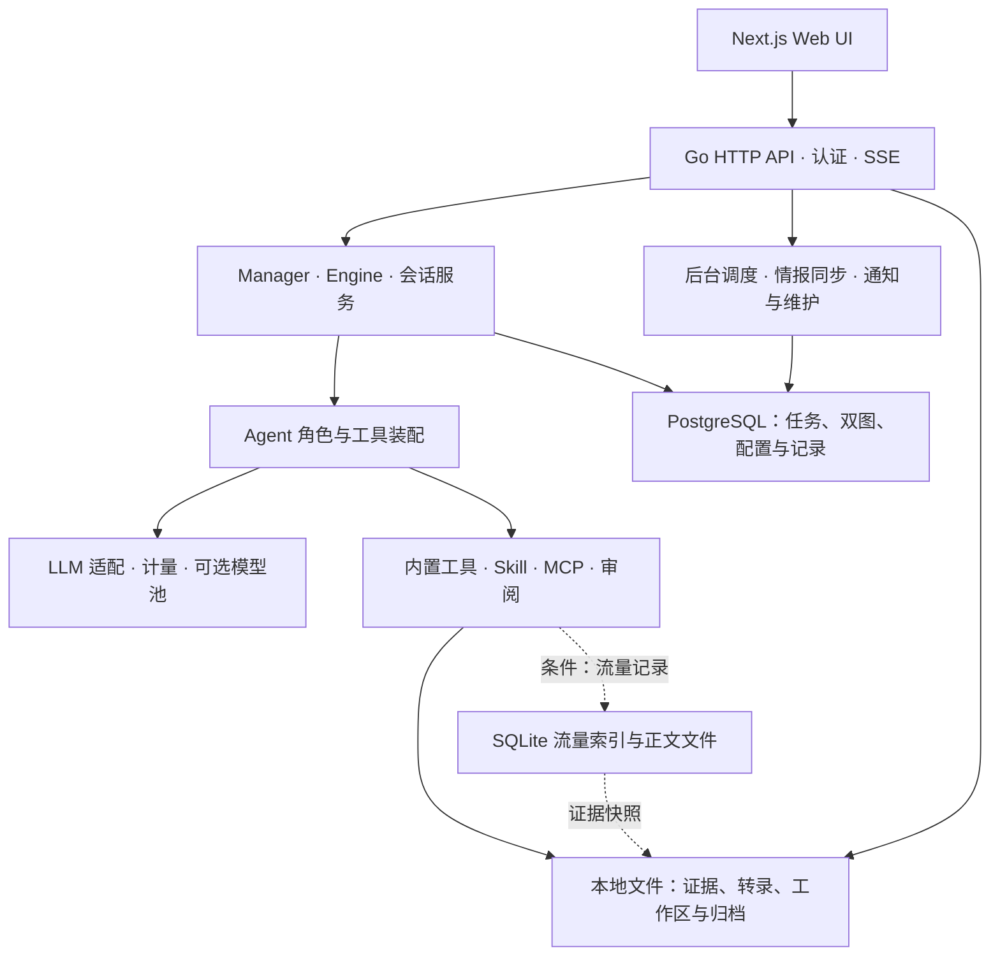
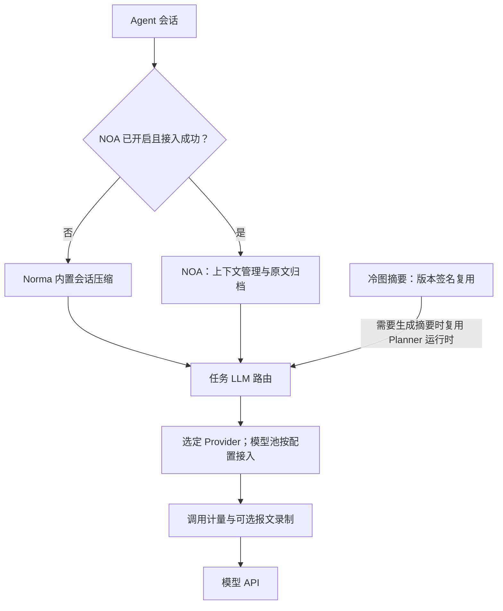
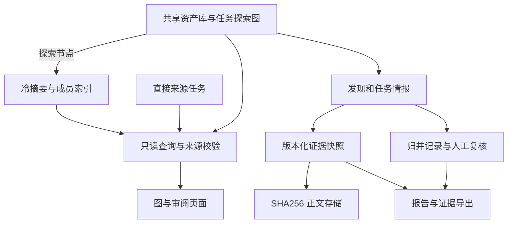
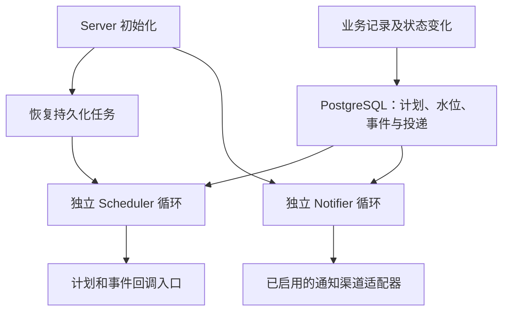

# ARTEX 当前架构、能力与接线状态

> 源码接线、配置生效、CI 结果与实际部署可用性分别记录。本文用于项目理解、资讯适配与人工审阅。

## 核验快照

| 项目 | 当前记录 |
| --- | --- |
| 仓库 | [MythHack/ARTEX](https://github.com/MythHack/ARTEX) |
| 源码基线 | main；[675479c881bf27f6ceebfb3347a2319f0f170dff](https://github.com/MythHack/ARTEX/commit/675479c881bf27f6ceebfb3347a2319f0f170dff) |
| 提交时间 | 2026-11-01 00:51:12，Asia/Shanghai |
| 核验日期 | 2026-11-01，Asia/Shanghai |
| 范围 | 服务装配、核心 Agent/LLM、上下文、双图、证据、MCP/工具、后台服务、报告及相关前端 |
| 方法 | 静态源码与必要调用方核对；读取匹配提交已有的 GitHub CI 记录 |
| 部署状态 | 未取得实际部署的配置、进程或服务日志；运行可用性未验证 |
| CI 概况 | 前端构建、后端 Build/Vet 成功；后端 Test 失败 |
| 维护 | 每日检查默认分支、接线和 CI；有实质变化时更新文档并提交维护 PR |

**已实现**表示找到具体实现；**已接线**表示找到调用或注册；**条件接线**需要开关、绑定或外部依赖；**运行未验证**表示缺少部署证据。库函数存在、设计文档、CI 成功和实际可用性分别记录。

## 整体架构

箭头表示模块依赖或数据关系，条件连接受配置影响。

入口 `run()` 创建 Manager、Server 和 HTTP 服务；`server.New` 将任务 Agent 解析器接到 Engine，并装配工具和后台服务；`NewManager` 打开 PostgreSQL，按条件创建流量和情报组件。[入口][arch-main]、[Server][arch-server]、[Manager][arch-manager]

### 启动与存储边界

| 层 | 当前接线 | 生效与可用条件 |
| --- | --- | --- |
| 主服务 | `run → NewManager → server.New → Handler`。[入口][arch-main] | Manager 需要 PostgreSQL；部署连通性未验证。 |
| 任务/会话控制 | `server.New` 设置任务级及固定 Worker 解析器、恢复任务、检查 readiness。[Server][arch-server] | 全局模型就绪与单任务能否解析可用模型分别判断。 |
| 工具装配 | `wireAgentAugment / wireTools` 处理 Skill/MCP、角色绑定、开关和 schema。[装配][arch-assembly] | 实际工具集取决于配置与外部依赖。 |
| PostgreSQL | 保存任务、资产/探索关系、配置、审批、用量及业务元数据。[Manager][arch-manager] | 本次未连接实际数据库。 |
| 流量 SQLite | `traffic.Open` 创建 `_index/index.sqlite` 与正文目录。[traffic][arch-traffic] | 流量实例初始化、监听成功和 capture 开关分别判断。 |
| 本地文件 | 保存流量正文、独立证据、会话转录、工作区及归档。[证据][arch-evidence] | 需要权限、磁盘空间和可读原文；实际状态未验证。 |

## 当前 CI 与运行验证

基线提交的 [CI 运行 41221669712][arch-ci-run] 于 2026-11-01 00:54:34（Asia/Shanghai）结束，总结论为 **failure**。这是读取已有记录，未重新执行或部署项目。

| 检查 | 已记录结果 | 结论范围 |
| --- | --- | --- |
| Frontend Install / Build (static export) | 成功 | 该 CI 环境的安装、构建与静态导出通过。 |
| Backend Build | 成功 | `go build ./...` 通过。 |
| Backend Vet | 成功 | `go vet ./...` 通过。 |
| Backend Test | 失败 | 全量回归状态不能记为通过。 |
| 用户部署 | 未验证 | 缺少配置、连通、数据库健康与实际操作证据。 |

失败记录涉及 `agent`、`db`、`intercept`、`selfupdate` 包。顶层失败测试包括 `TestCaptureApprovalLifecycle`、`TestInterceptApprovalFilters`、`TestSideTaskArchiveVersions`、`TestJudgeRetriesBeforeApplyingFailurePolicy`、`TestFetchLatestUsesForkRelease`、`TestFetchLatestMissingRelease`。失败根因及部署影响尚未确认；日志中的预期失败样例或数据库探活错误不能自动视为独立产品故障。[工作流][arch-ci]、[backend job][arch-ci-backend]、[frontend job][arch-ci-frontend]

## LLM、上下文与缓存

本节的代码基线为 [`675479c8`](https://github.com/MythHack/ARTEX/commit/675479c881bf27f6ceebfb3347a2319f0f170dff)。下文“已实现并接线”表示已核对实现及调用位置；开关是否开启、网关是否支持、实际效果是否满足要求，仍须由对应部署的配置和运行记录确认。

### 调用与上下文关系

这张图描述当前任务路径的关系。**NOA 与 Norma 内置会话压缩互斥；冷图摘要是独立的图状态派生功能。** 开启 NOA 并不意味着移除冷图摘要。图中省略了 HTTP 传输层的限流、会话头和重试细节；模型池是否接入取决于配置来源及开关。[会话接线][llm-task]、[NOA 接线][llm-noa]、[冷图摘要][llm-compaction]

### 能力、接线与可用状态

| 能力 | 当前实现及接线证据 | 配置条件与状态 | 运行验证状态 |
| --- | --- | --- | --- |
| 多种模型 API 接入 | `ConfigFrom` 支持 Anthropic、OpenAI Chat Completions、OpenAI Responses；提供流式/非流式、输出上限及思考参数配置。[provider][llm-provider] | **已实现**；依赖有效 profile、凭据及端点兼容性。 | 未连接实际模型验证；配置项存在不代表上游支持。 |
| 任务模型解析 | `taskLLMRuntime.current` 先处理固定模型 Worker，再按角色绑定、任务链、全局配置解析；配置链耗尽会显式报错。[task_llm][llm-task] | **已实现并接线**；具体选择由部署配置决定。 | 未读取实际 profile、角色绑定或任务链。 |
| 模型池与熔断 | `poolChain`、`order`、健康注册表实现显式优先级、同优先级轮换、窗口过滤、失败转移和冷却。[接线][llm-pool-wiring]、[模型池][llm-pool]、[健康状态][llm-health] | **配置可选**；`llm_pool_enabled` 默认关闭；绑定模型回退还有独立开关。 | 未确认部署是否开启。不能把容错选路描述为基于质量/成本预测的自动选模。 |
| Norma 内置会话压缩 | `compactionConfig` 为会话生成窗口配置；任务运行时解析角色对应窗口。[provider][llm-provider]、[task_llm][llm-task] | **已实现并接线**；NOA 未开启或接入失败时保留这条路径。 | 未验证实际触发次数、摘要效果或节省比例。 |
| NOA 上下文管理 | `enableNoa` 调用 `noaadapter.Enable`，接入原文归档；成功后清除 `opts.Compaction`，失败时保留内置会话压缩。[noa][llm-noa] | **实验性、配置可选**；`noa_compaction` 默认关闭，每次 run 读取；不是冷图摘要的替代开关。 | 未确认启用状态，未验证归档完整性和压缩质量。 |
| 冷图摘要与摘要复用 | `coldgraph.go` 计算冷热、关系分组及内容版本签名；`major()` 复用签名未变的摘要，避免再次调用模型；新摘要通过 `compress()` 生成。[图算法][llm-coldgraph]、[压缩实现][llm-compaction] | **已实现并接线**；`agentsForTask` 把 Compactor 注入 Planner。触发依赖图状态和阈值。 | 未验证运行中的摘要命中率、语义保真、净 token 节省。 |
| Compactor 模型来源 | 当前任务构建调用 `NewCompactor(plannerRuntime, "task-router")`，因此这条路径复用 Planner 运行时。[task_llm][llm-task] | **文档与任务实现有差异**：模型路由策略文档称 Compactor 可独立配模，当前任务接线没有建立独立 Compactor 运行时。 | 独立选模的可用性不能据策略文档确认；需要定位实际调用路径。 |
| 压缩输出预算 | 任务构建注入 `CompactionMaxTokens/CompactionThinking`；`resolveBodyBudget` 每次调用读取这些解析器。[manager][llm-manager]、[compaction][llm-compaction] | **已实现并接线**；当前任务路径的未配置默认为 6000、`disabled`。构造器保留的 65536 不是这条路径的有效默认。 | 未读取实际设置；上游对思考参数的行为仍须实测。 |
| Token 与调用记录 | `Recorder.Stream/Complete` 写轻量用量记录；完整请求、响应和原始报文由独立开关控制；计量含任务、角色、模型、profile、耗时、输入/输出与缓存 token。[Recorder][llm-rec]、[账本][llm-usage] | **已实现并接线**；轻量计量不受完整录制开关控制。落库为尽力而为，上游 usage 缺失会限制计量。 | 未核验当前部署的记录完整度、费用换算或不同调用路径的归因。 |
| HTTP 尝试限流 | `RequestLimiter` 在 HTTP 尝试层按秒/分钟滚动窗口控制请求，包括重试。[限流器][llm-limiter] | **已实现**；限额由 profile 配置；不是 token 预算限制。 | 未验证实际配置及流量下的限流行为。 |

### 缓存语义

当前代码中有三种不同含义，架构更新和资讯适配判断应保持区分：

1. **上游缓存协作。** `SessionHeaderKey` 可让请求携带稳定会话 ID，供支持该约定的网关使用。是否缓存及是否命中由上游决定；这本身不是 ARTEX 的语义响应缓存。[provider][llm-provider]
2. **缓存用量计量。** `CacheRead/CacheWrite` 保存供应商返回的缓存 token；有统计字段不能证明主动缓存功能或缓存命中。[Recorder][llm-rec]、[账本][llm-usage]
3. **冷图摘要精确复用。** 摘要签名覆盖成员、锚点的 ID 和内容版本；签名未变时可以直接复用既有摘要。这是已核实的调用减少机制。[coldgraph][llm-coldgraph]、[compaction][llm-compaction]

本轮核对的核心路径没有显示通用的向量相似请求命中后直接复用回答机制，也没有显示基于质量或费用预测的学习型选模器。该结论限定于已核对的 ARTEX 代码路径；外部 Norma SDK 和上游服务的内部实现未在本节逐文件验证。

### “能力不变、用量减少”的证据要求

当前实现能提供 token、缓存 token、调用耗时和错误状态等数据，但这些指标单独不能证明能力保持不变。评价新算法时，应在相同脱敏材料与任务要求下核对事实保留、引用正确性、结论一致性及遗漏，同时计入摘要、重试和缓存维护本身的消耗。需要权重访问、KV cache 控制或自托管推理引擎的方法，应标明额外部署条件；不能描述为现有模型 API 接入方式即可直接使用。本文不声称当前部署已达到某个节省比例。

[llm-provider]: https://github.com/MythHack/ARTEX/blob/675479c881bf27f6ceebfb3347a2319f0f170dff/agent/provider.go
[llm-task]: https://github.com/MythHack/ARTEX/blob/675479c881bf27f6ceebfb3347a2319f0f170dff/server/task_llm.go
[llm-noa]: https://github.com/MythHack/ARTEX/blob/675479c881bf27f6ceebfb3347a2319f0f170dff/agent/noa.go
[llm-compaction]: https://github.com/MythHack/ARTEX/blob/675479c881bf27f6ceebfb3347a2319f0f170dff/agent/compaction.go
[llm-coldgraph]: https://github.com/MythHack/ARTEX/blob/675479c881bf27f6ceebfb3347a2319f0f170dff/agent/coldgraph.go
[llm-pool-wiring]: https://github.com/MythHack/ARTEX/blob/675479c881bf27f6ceebfb3347a2319f0f170dff/server/llmpool.go
[llm-pool]: https://github.com/MythHack/ARTEX/blob/675479c881bf27f6ceebfb3347a2319f0f170dff/llmpool/pool.go
[llm-health]: https://github.com/MythHack/ARTEX/blob/675479c881bf27f6ceebfb3347a2319f0f170dff/llmpool/health.go
[llm-manager]: https://github.com/MythHack/ARTEX/blob/675479c881bf27f6ceebfb3347a2319f0f170dff/server/manager.go
[llm-rec]: https://github.com/MythHack/ARTEX/blob/675479c881bf27f6ceebfb3347a2319f0f170dff/llmrec/llmrec.go
[llm-usage]: https://github.com/MythHack/ARTEX/blob/675479c881bf27f6ceebfb3347a2319f0f170dff/db/llm_usage.go
[llm-limiter]: https://github.com/MythHack/ARTEX/blob/675479c881bf27f6ceebfb3347a2319f0f170dff/agent/request_limiter.go

## 数据、证据、展示与交付

本节核对基线为提交 `675479c881bf27f6ceebfb3347a2319f0f170dff`。下列“已接线”表示已找到实现、调用者及接口或界面入口；没有启动实例、连接运行数据库或执行端到端验证，因此不表示用户部署已经启用、数据完整或运行效果达标。配置开关与数据库中的工具绑定会继续影响实际可用性。

### 数据关系

图中的来源任务通过显式关联提供只读资料；冷摘要保存成员关联，完整记录仍可追溯。证据快照中的元数据保存在 PostgreSQL，请求与响应正文按内容哈希保存在文件系统。不同导出格式的数据装配并不完全相同，不能仅凭共用模板推定各格式都已携带完整流量证据。

### 能力、接线与可用状态

| 能力 | 实际实现 | 调用与接线证据 | 配置或依赖 | 核对状态 |
| --- | --- | --- | --- | --- |
| 资产图、探索图与血缘 | 资产、探索节点、关系边和资产锚点分别存储；探索记录可保留事实、发现、目标及来源。覆盖图从资产库及任务范围构造，探索图读取节点与边。 | [db/assets.go](https://github.com/MythHack/ARTEX/blob/675479c881bf27f6ceebfb3347a2319f0f170dff/db/assets.go)、[db/exploration.go](https://github.com/MythHack/ARTEX/blob/675479c881bf27f6ceebfb3347a2319f0f170dff/db/exploration.go)；[server/server.go](https://github.com/MythHack/ARTEX/blob/675479c881bf27f6ceebfb3347a2319f0f170dff/server/server.go) 的 `taskCoverageGraph` 调用 `BuildCoverageGraph`，`explorationGraph` 读取 `Nodes/Edges`，对应路由已注册。 | PostgreSQL、已存在的任务与资产数据。覆盖度展示受任务 `coverage_enabled` 影响。 | 数据与 HTTP 读取路径已接线；真实数据规模下的完整性、查询性能及运行状态未知。 |
| 冷摘要、成员展开与原文恢复 | `digest` 节点通过 `covers` 边记录成员；摘要有有效/被替代状态，原成员继续保留；`expand_digest` 返回成员紧凑信息，完整详情另行读取。 | [db/digest.go](https://github.com/MythHack/ARTEX/blob/675479c881bf27f6ceebfb3347a2319f0f170dff/db/digest.go) 的 `AddDigest/DigestMembers/SupersedeDigests`；[agent/compaction.go](https://github.com/MythHack/ARTEX/blob/675479c881bf27f6ceebfb3347a2319f0f170dff/agent/compaction.go) 调用 `AddDigest`；[server/task_llm.go](https://github.com/MythHack/ARTEX/blob/675479c881bf27f6ceebfb3347a2319f0f170dff/server/task_llm.go) 的 `agentsForTask` 创建并接入 Compactor；[agent/tools_digest.go](https://github.com/MythHack/ARTEX/blob/675479c881bf27f6ceebfb3347a2319f0f170dff/agent/tools_digest.go) 与 [agent/tools.go](https://github.com/MythHack/ARTEX/blob/675479c881bf27f6ceebfb3347a2319f0f170dff/agent/tools.go) 注册展开工具。 | 可用的模型通道、压缩阈值和预算、符合压缩条件的数据；实际工具可见性受数据库绑定影响。 | 生成、存储、展开路径已接线；不等同于摘要质量已验证，也不等同于已实现语义检索。 |
| 直接关联任务的只读继承 | `task_relations` 指明来源；节点和活动带 `inherited/source_task_id`；只展开直接关系，不递归读取来源的来源。继承意图仅暴露允许的终态。 | [db/exploration_sources.go](https://github.com/MythHack/ARTEX/blob/675479c881bf27f6ceebfb3347a2319f0f170dff/db/exploration_sources.go) 的 `DirectSourceStores/GetNodeWithSources`；[server/server.go](https://github.com/MythHack/ARTEX/blob/675479c881bf27f6ceebfb3347a2319f0f170dff/server/server.go) 的 `explorationGraph` 合并经 `inheritedGraphSnapshot` 过滤的来源图；[server/finding_traffic.go](https://github.com/MythHack/ARTEX/blob/675479c881bf27f6ceebfb3347a2319f0f170dff/server/finding_traffic.go) 的 `findingTrafficAccess` 与 [server/finding_cases.go](https://github.com/MythHack/ARTEX/blob/675479c881bf27f6ceebfb3347a2319f0f170dff/server/finding_cases.go) 的 `findingCaseAccess` 拒绝在继承上下文写入。 | 已保存的来源任务关系、未删除的来源任务；来源任务的修改应回到原任务上下文。 | 查询与上下文写保护已接线；部署中的关系配置及实际资料覆盖未知。 |
| 任务情报的事实与推断区分 | 记录类型、来源证据、资产、状态、`observed/inferred`；录入校验拒绝将推断直接标为验证成功；内容指纹去重，系统绑定任务与来源节点。可随事实批量写回。 | [db/intelligence.go](https://github.com/MythHack/ARTEX/blob/675479c881bf27f6ceebfb3347a2319f0f170dff/db/intelligence.go) 的 `NormalizeIntelligence/RecordIntelligence`；[agent/intelligence.go](https://github.com/MythHack/ARTEX/blob/675479c881bf27f6ceebfb3347a2319f0f170dff/agent/intelligence.go) 的 `intelligenceWorkflow`；[server/assembly.go](https://github.com/MythHack/ARTEX/blob/675479c881bf27f6ceebfb3347a2319f0f170dff/server/assembly.go) 的 `wireTools` 注入记录回调；[server/intelligence.go](https://github.com/MythHack/ARTEX/blob/675479c881bf27f6ceebfb3347a2319f0f170dff/server/intelligence.go)、[intelligence-panel.tsx](https://github.com/MythHack/ARTEX/blob/675479c881bf27f6ceebfb3347a2319f0f170dff/web/src/components/intelligence-panel.tsx) 接入读取与状态编辑。 | `task_intelligence_enabled` 在读取缺省值时为 `false`；还需当前任务上下文及工具绑定。 | 条件接线已确认；不能据源码断言部署已开启。关键词检索主要使用 SQL `ILIKE`。 |
| SHA256 正文与证据快照 | 请求/响应正文内容寻址、长度和哈希校验、相同内容复用；快照与可清理的原始流量分离；绑定变化递增证据版本；无引用数据按保留窗口回收。 | [evidence/store.go](https://github.com/MythHack/ARTEX/blob/675479c881bf27f6ceebfb3347a2319f0f170dff/evidence/store.go) 的 `writeBody/Record/Bind/OpenBody/RunGC`；[db/finding_traffic.go](https://github.com/MythHack/ARTEX/blob/675479c881bf27f6ceebfb3347a2319f0f170dff/db/finding_traffic.go) 的快照、绑定及版本函数；[server/task_llm.go](https://github.com/MythHack/ARTEX/blob/675479c881bf27f6ceebfb3347a2319f0f170dff/server/task_llm.go) 将证据 Store 注入各任务 Agent；[server/server.go](https://github.com/MythHack/ARTEX/blob/675479c881bf27f6ceebfb3347a2319f0f170dff/server/server.go) 启动证据 GC。 | PostgreSQL、可写证据目录；新流量绑定需要原始流量记录存在且正文可读取。 | 持久化、读取与 GC 调用已接线；文件系统、数据库和现有证据的运行健康未知。 |
| 证据审阅、分页读取与版本约束 | HTTP 接口支持绑定、用途/备注编辑、排序、删除、详情、正文分段读取与下载；写入使用版本校验；保存报告时记录所依据的证据版本。 | [server/finding_traffic.go](https://github.com/MythHack/ARTEX/blob/675479c881bf27f6ceebfb3347a2319f0f170dff/server/finding_traffic.go) 的 `registerFindingTraffic` 注册接口；[server/orchestration.go](https://github.com/MythHack/ARTEX/blob/675479c881bf27f6ceebfb3347a2319f0f170dff/server/orchestration.go) 注册 `get_finding_traffic/bind_finding_traffic`；[finding-traffic-panel.tsx](https://github.com/MythHack/ARTEX/blob/675479c881bf27f6ceebfb3347a2319f0f170dff/web/src/components/finding-traffic-panel.tsx) 经 [web/src/lib/api.ts](https://github.com/MythHack/ARTEX/blob/675479c881bf27f6ceebfb3347a2319f0f170dff/web/src/lib/api.ts) 调用；[server/finding_workflow.go](https://github.com/MythHack/ARTEX/blob/675479c881bf27f6ceebfb3347a2319f0f170dff/server/finding_workflow.go) 校验绑定工具开关。 | Agent 自动绑定受 `agent_traffic_binding` 控制，缺省读取为 `false`；已保存证据的读取不依赖捕获开关。 | REST、工具和界面读取路径已接线；实际工具授权、捕获状态和证据数量未知。 |
| 精确去重、归并建议与人工复核 | 同任务的符合条件记录按类别、名称和资产指纹合并追加证据；归并组保存成员与事件，疑似分组可人工接受/否决并保留否决约束；统一报告使用组版本校验。 | [db/finding_traffic.go](https://github.com/MythHack/ARTEX/blob/675479c881bf27f6ceebfb3347a2319f0f170dff/db/finding_traffic.go) 的 `FindingFingerprint/RecordFindingTx`；[db/finding_cases.go](https://github.com/MythHack/ARTEX/blob/675479c881bf27f6ceebfb3347a2319f0f170dff/db/finding_cases.go) 的归并函数；[server/finding_cases.go](https://github.com/MythHack/ARTEX/blob/675479c881bf27f6ceebfb3347a2319f0f170dff/server/finding_cases.go) 注册工具并提供审核入口；[finding-case-list.tsx](https://github.com/MythHack/ARTEX/blob/675479c881bf27f6ceebfb3347a2319f0f170dff/web/src/components/finding-case-list.tsx) 调用建议、接受/否决、成员查询接口。 | 人工发起的模型整理需 Reporter 启用且模型可用；手动操作与模型工具仍受对应范围和绑定约束。 | 数据、HTTP、工具及界面已接线。疑似分组需要人工确认；证据充分时 Reporter 存在直接归并入口，不能概括为“所有归并逐条等待人工批准”。 |
| Markdown、CSV、JSON 与证据 ZIP | 支持按筛选、所选记录或全部记录导出；可按归并组整合；导出前冻结证据绑定/报告版本，ZIP 复制证据正文并包含可引用附件。 | [server/server.go](https://github.com/MythHack/ARTEX/blob/675479c881bf27f6ceebfb3347a2319f0f170dff/server/server.go) 的 `findingsExport` 调用 `StageFindingsExport`，再调用 [report/findings.go](https://github.com/MythHack/ARTEX/blob/675479c881bf27f6ceebfb3347a2319f0f170dff/report/findings.go)；[server/finding_cases_export.go](https://github.com/MythHack/ARTEX/blob/675479c881bf27f6ceebfb3347a2319f0f170dff/server/finding_cases_export.go) 处理整合；[web/src/lib/api.ts](https://github.com/MythHack/ARTEX/blob/675479c881bf27f6ceebfb3347a2319f0f170dff/web/src/lib/api.ts) 的 `exportFindings` 触发下载。 | PostgreSQL、可读证据正文、可写临时目录、足够存储空间。 | 已找到端到端静态调用链；未验证下载、文件内容与大体积导出。 |
| DOCX 总报告与单条报告 | Word 模板、HTTP 导出入口及前端下载调用存在；可处理报告正文、资产名称、严重度分组和复测记录。模板还包含流量证据小节。 | [server/report_export.go](https://github.com/MythHack/ARTEX/blob/675479c881bf27f6ceebfb3347a2319f0f170dff/server/report_export.go) 的 `exportTaskDocx/exportFindingDocx` 调用 [report/docx_build.go](https://github.com/MythHack/ARTEX/blob/675479c881bf27f6ceebfb3347a2319f0f170dff/report/docx_build.go) 的模板；任务 [report-tab.tsx](https://github.com/MythHack/ARTEX/blob/675479c881bf27f6ceebfb3347a2319f0f170dff/web/src/app/%28main%29/function/tasks/detail/_tabs/report-tab.tsx) 经 `downloadTaskDocx` 调用。 | PostgreSQL；读取已保存报告不要求新的模型调用。 | 基本导出路径已接线；**流量绑定到 Word 的数据装配存在待核对项**，详见下文，不能记为完整可用。未进行 Word 渲染验证。 |
| 探索图、资产图与网络分区视图 | 探索图具有摘要收缩、关系边去重、成员详情、分层布局及可见元素渲染；覆盖图支持资产/网络两种视图、分区、折叠展开、路径高亮。 | [graph-tab.tsx](https://github.com/MythHack/ARTEX/blob/675479c881bf27f6ceebfb3347a2319f0f170dff/web/src/app/%28main%29/function/tasks/detail/_tabs/graph-tab.tsx) 调用 `api.explorationGraph`；[exploration-graph.tsx](https://github.com/MythHack/ARTEX/blob/675479c881bf27f6ceebfb3347a2319f0f170dff/web/src/components/exploration-graph.tsx) 渲染；[coverage-graph-tab.tsx](https://github.com/MythHack/ARTEX/blob/675479c881bf27f6ceebfb3347a2319f0f170dff/web/src/app/%28main%29/function/tasks/detail/_tabs/coverage-graph-tab.tsx) 调用 `api.taskCoverageGraph`，后端路由和数据构造函数已对应。 | 前端构建、浏览器、后端 API 和资产/探索数据；关闭覆盖度时仍可显示资产关系，但抹平已测标记。 | UI 与 API 已接线；未做浏览器实测。网络视图的边表示归属/关联，不证明实际网络可达性。 |

### 已确认边界与仍需核对的接线

- **两个图与业务模型的边界。** 已核对的存储和图组件围绕资产、探索血缘、摘要和覆盖展示；这些实现不能作为“独立的模块—业务对象—操作—状态模型已经完成”的证据。业务事实可以存在于原始记录中，但结构化程度和完整性需结合实际数据核验。
- **查询与语义检索的边界。** 所读节点、活动与情报查询主要使用关键词过滤；冷摘要及图结构本身不证明嵌入检索、语义缓存或 GraphRAG 已实现。
- **归并判定的边界。** `FindingCaseCandidates` 使用类别、名称、资产重叠召回候选。候选分数不是根因相同的证明；疑似建议、人工决定与 Reporter 的直接归并入口应分别描述。
- **情报状态校验的边界。** `NormalizeIntelligence` 在录入时限制 `inferred` 与已验证状态组合；人工编辑走的 `UpdateIntelligenceStatus` 单独校验类别和状态，没有再次校验该组合。因此应描述为“录入约束”，不能把它宣称为全生命周期不变量。
- **Word 流量证据接线。** `writeTrafficEvidenceDocx` 仅在 `DBFinding.TrafficBindings` 非空时输出流量小节。但当前 `exportTaskDocx/exportFindingDocx` 分别从 `ListFindingsForExport/GetFinding` 取数据后直接调用模板；这两个查询填充版本及数量，没有填充绑定切片，也没有经过发现页导出的 `StageFindingsExport`。因此只能确认模板存在，不能将 HTTP Word 导出记为完整携带流量绑定。该判断来自上述函数间的静态数据流，尚未运行复现。
- **Word 资产统计范围。** 当前任务 Word 路径调用 `Assets().QueryByType` 构造资产计数及附录，没有在这处传入任务范围。因而不能将该统计描述为已经严格限定于当前任务；实际输出需结合数据库内容核对。
- **运行状态。** 尚未读取实例配置、工具绑定或运行数据库，未验证数据迁移、证据目录权限、开关值、模型可用性、页面渲染及导出结果。后续维护应继续区分“实现存在”“调用已接线”“配置已启用”“实例实测通过”，不要互相替代。

## 外围集成与后台服务

核对基线：`MythHack/ARTEX` 的提交 [`675479c881bf27f6ceebfb3347a2319f0f170dff`](https://github.com/MythHack/ARTEX/commit/675479c881bf27f6ceebfb3347a2319f0f170dff)，提交时间为 2026-11-01 00:51:12（北京时间）。本节是源码静态核对：**实现存在、入口已接线、配置满足、运行成功是四种不同证据**。没有读取部署数据库、连接外部服务或执行项目，因此本节所有外部集成的运行状态均为“未验证”，不能据源码默认值判定用户部署已启用。

### 后台接线概览

图中各入口已在源码中找到；配置是否满足及实际触发、送达状态仍待部署证据。

### 实际接线与依赖

| 能力 | 实现存在 | 入口与实际接线 | 配置和环境依赖 | 本次可用状态 |
|---|---|---|---|---|
| MCP 三类传输、工具发现 | `connectMCP` 分派 stdio、Streamable HTTP、旧 SSE；发现工具名称和描述后写入数据库缓存 | `Server.New` 调用 `wireAgentAugment`，并异步调用 `discoverEmptyMCPsOnStartup`；装配器连接启用且对当前 Agent 可见或被可见 Skill 引用的 MCP，再调用 `Tools` | MCP 行启用、Agent/Skill 可见性、可执行命令或服务 URL、必要认证、对应服务健康 | 源码已接线；配置未核对；连接与工具调用未验证。缓存里有工具名称不代表现在可连接。见 [mcpdiscover.go](https://github.com/MythHack/ARTEX/blob/675479c881bf27f6ceebfb3347a2319f0f170dff/server/mcpdiscover.go)、[assembly.go](https://github.com/MythHack/ARTEX/blob/675479c881bf27f6ceebfb3347a2319f0f170dff/server/assembly.go)、[client.go](https://github.com/MythHack/ARTEX/blob/675479c881bf27f6ceebfb3347a2319f0f170dff/mcphttp/client.go)。 |
| Skill 与工具的渐进暴露 | 装配器区分直接可见和 Skill 关联工具；建立调用解锁集合；延迟工具通过统一入口暴露 | `Server.New → wireAgentAugment → agent.ToolAugment`，同时从数据库加载可见 Skill 与工具绑定；`s.hostTools` 合并平台工具、用户自定义工具与条件可用的流量工具 | Skill 目录可读、合法元数据、数据库可见性/绑定、对应工具实现及环境 | 已见调用接线；未验证任何实际 Skill 或工具运行。延迟 schema/解锁不等于完全按需启动外部进程。见 [assembly.go](https://github.com/MythHack/ARTEX/blob/675479c881bf27f6ceebfb3347a2319f0f170dff/server/assembly.go)、[orchestration.go](https://github.com/MythHack/ARTEX/blob/675479c881bf27f6ceebfb3347a2319f0f170dff/server/orchestration.go)。 |
| MCP 失败冷却与输出体积管理 | 按服务名记录连接失败窗口；HTTP/SSE 工具结果交给 SDK `Capture` 处理 | `wireAgentAugment` 实际调用 `mcpFailedUntil / markMCPFailed / clearMCPFailure`；`Client.wrap` 调用 `actool.Capture` | 当前失败状态、SDK 的工具输出目录与输出预算；磁盘可写 | 通用机制已接线；收益和信息保留效果未测。元数据缓存、失败缓存与调用结果缓存应分别表述。见 [mcp_failure_cache.go](https://github.com/MythHack/ARTEX/blob/675479c881bf27f6ceebfb3347a2319f0f170dff/server/mcp_failure_cache.go)、[client.go](https://github.com/MythHack/ARTEX/blob/675479c881bf27f6ceebfb3347a2319f0f170dff/mcphttp/client.go)。 |
| 宿主工具与 Python 库清单 | CLI 查 PATH；Python 库批量检查 `importlib.util.find_spec`；字典检查真实目录；有探测缓存与失效入口 | `Server.New` 注入 Python 和数据目录 resolver；`hostenvStatus` 返回 `hosttools.Inventory()`；相关摘要可供系统能力展示使用 | 宿主 PATH、选定 Python、实际安装库与目录、文件权限 | 探测实现与状态 API 已接线；本次未运行 Inventory，不能报告某个工具已安装。见 [hosttools.go](https://github.com/MythHack/ARTEX/blob/675479c881bf27f6ceebfb3347a2319f0f170dff/hosttools/hosttools.go)、[hostenv_api.go](https://github.com/MythHack/ARTEX/blob/675479c881bf27f6ceebfb3347a2319f0f170dff/server/hostenv_api.go)、[server.go](https://github.com/MythHack/ARTEX/blob/675479c881bf27f6ceebfb3347a2319f0f170dff/server/server.go)。 |
| 可选宿主安装助手 | `hostd` 有白名单、安装任务状态、日志及串行执行；主服务经 Unix socket 转发 | `Server.Handler` 注册宿主状态/安装/任务接口；`hostenvInstall → hostdCall`；`hostd.Server.Start` 再核对目录白名单；`Server.New` 启动助手版本协调 | 单独运行的 `artex-hostd`、可访问的 socket、支持的系统/包管理器、下载连通性和权限；并非所有部署形态都有助手 | 调用路径已存在；助手是否安装、在线、版本一致、安装是否成功均未验证。主服务可运行不代表助手可用。见 [hostenv_api.go](https://github.com/MythHack/ARTEX/blob/675479c881bf27f6ceebfb3347a2319f0f170dff/server/hostenv_api.go)、[hostd/server.go](https://github.com/MythHack/ARTEX/blob/675479c881bf27f6ceebfb3347a2319f0f170dff/hostd/server.go)。 |
| 流量记录、检索和大正文存储 | `traffic.Open` 初始化代理、SQLite 索引、内容寻址 blob 和 CA 目录；支持检索、正文读取及索引回收逻辑 | `NewManager` 在非空代理地址下调用 `traffic.Open` 并启动 `Traffic.Start`；`Manager.HostTools` 在记录实例存在且捕获开关打开时返回工具；HTTP 查询接口在 `Server.Handler` 注册；浏览器配置由 `syncBrowserMCPProxy` 协调 | 记录实例初始化成功、代理监听成功、捕获开关、流量实际经过记录链路、CA/网络配置、可写数据目录；全文索引还取决于初始化结果 | 已接线；监听/捕获/检索均未运行验证。对象存在与记录开关为真不等于代理已成功监听；某些协议错误可能透明转发而不留存正文。见 [manager.go](https://github.com/MythHack/ARTEX/blob/675479c881bf27f6ceebfb3347a2319f0f170dff/server/manager.go)、[traffic.go](https://github.com/MythHack/ARTEX/blob/675479c881bf27f6ceebfb3347a2319f0f170dff/traffic/traffic.go)。 |
| 公开情报同步与检索 | NVD/KEV、GHSA 补充、可选公开资料聚合；有数据库 Store、时间/分页游标、共享 API 放行控制和来源状态 | `NewManager` 创建 Store 并注入 Agent；启动设置允许时拉起主同步与独立近期更新循环；主同步调用 `vulnintel.Run`，GHSA 由独立更新路径调用；状态、配置和手动同步接口已注册 | PostgreSQL 表、同步开关、外部来源可达性、代理、可选 API 凭据及来源额度；首次补全完成情况 | 实现和条件入口已确认；外部来源当前可达性、同步水位与实际数据完整性未验证。已有同步器不等于库已完整。见 [manager.go](https://github.com/MythHack/ARTEX/blob/675479c881bf27f6ceebfb3347a2319f0f170dff/server/manager.go)、[vulnintel_sync.go](https://github.com/MythHack/ARTEX/blob/675479c881bf27f6ceebfb3347a2319f0f170dff/server/vulnintel_sync.go)、[sync.go](https://github.com/MythHack/ARTEX/blob/675479c881bf27f6ceebfb3347a2319f0f170dff/vulnintel/sync.go)、[intel.go](https://github.com/MythHack/ARTEX/blob/675479c881bf27f6ceebfb3347a2319f0f170dff/vulnintel/intel.go)。 |
| 规则审查、模型研判和人工审批 | `Guard` 注册工具前后 hook；拦截器有规则匹配、研判、人工等待、审计及取消/超时处理；审查输入含有界人工背景与脚本快照 | 任务恢复/创建使用 `guard.NewWithInterceptor`；对话使用 `chatGuard`；`Server.New → wireInterceptReviewer → Interceptor.SetReviewer`；管理与人工处理接口在 Handler 注册 | 纳管工具配置、规则、研判开关/模型 profile、数据库、审阅者；审查覆盖还取决于具体调用路径 | 代码接线已确认；部署覆盖范围、判定质量与人工流程未验证。已接线不能推导每次调用都经过同一种研判。见 [guard.go](https://github.com/MythHack/ARTEX/blob/675479c881bf27f6ceebfb3347a2319f0f170dff/guard/guard.go)、[intercept.go](https://github.com/MythHack/ARTEX/blob/675479c881bf27f6ceebfb3347a2319f0f170dff/server/intercept.go)、[review_context.go](https://github.com/MythHack/ARTEX/blob/675479c881bf27f6ceebfb3347a2319f0f170dff/intercept/review_context.go)、[intercept/intercept.go](https://github.com/MythHack/ARTEX/blob/675479c881bf27f6ceebfb3347a2319f0f170dff/intercept/intercept.go)。 |
| 计划窗口与事件触发 | Scheduler 读取计划/触发器和持久化水位；支持定时、记录新增、状态变化及工具活动等配置驱动触发；日历窗口记录控制历史 | `Server.New → restoreTaskRuntimes → newScheduler(s).Run`；`Scheduler.step` 调用计划窗口计算和各类触发检查；满足条件时调用现有会话入口；计划和触发器 API 已注册 | PostgreSQL、启用的计划/触发器、目标 Agent 配置及所需模型、时区、任务状态 | 后台循环接线已确认；真实计划触发和后续会话未验证。水位持久化不代表待执行触发队列全部持久化，`triggerQ` 是内存结构。见 [scheduler.go](https://github.com/MythHack/ARTEX/blob/675479c881bf27f6ceebfb3347a2319f0f170dff/server/scheduler.go)、[calendar_schedule.go](https://github.com/MythHack/ARTEX/blob/675479c881bf27f6ceebfb3347a2319f0f170dff/server/calendar_schedule.go)、[server.go](https://github.com/MythHack/ARTEX/blob/675479c881bf27f6ceebfb3347a2319f0f170dff/server/server.go)。 |
| 通知事件、投递与渠道 | 记录创建/状态变化可登记通知事件；数据库分派渠道投递；有实时/汇总、领取租约、按渠道限流、退避和分段续发；注册钉钉、飞书、企业微信、Webhook、Telegram、Email 适配器 | `RecordFindingTx / SetFindingStatusTx → RecordNotificationEventTx`；`Server.New` 单独启动 `newNotifier(s).Run`；`Notifier.step → FanOutPendingEvents → Claim… → channel.Send`；管理/测试/历史 API 已注册 | 通知总开关、启用且过滤匹配的渠道、合法目标与凭据、网络可达、待投递事件；详情回链另需外部基础 URL | 生产者到投递者的源码接线已确认；未发送消息；任何渠道的实际可达与送达均未验证。适配器已注册不等于用户已配置。见 [finding_traffic.go](https://github.com/MythHack/ARTEX/blob/675479c881bf27f6ceebfb3347a2319f0f170dff/db/finding_traffic.go)、[notification.go](https://github.com/MythHack/ARTEX/blob/675479c881bf27f6ceebfb3347a2319f0f170dff/db/notification.go)、[notifier.go](https://github.com/MythHack/ARTEX/blob/675479c881bf27f6ceebfb3347a2319f0f170dff/server/notifier.go)、[channel.go](https://github.com/MythHack/ARTEX/blob/675479c881bf27f6ceebfb3347a2319f0f170dff/notify/channel.go)。 |

### 数据边界应在总架构图中明确

- **PostgreSQL** 保存业务状态、设置、计划、Agent/MCP 元数据、审查记录、通知事件与投递状态等。主要初始化入口为 `server.NewManager → db.Open`。
- **流量 SQLite** 是独立存储：`traffic.Open` 打开 `data/traffic/_index/index.sqlite`；请求/响应元信息和较小正文保存在索引库，较大正文按 SHA256 写入 `data/traffic/_blobs`，索引记录引用。全文索引初始化失败时，代码保留元数据能力，但不会假定正文全文搜索可用。
- **文件系统** 还承载流量 CA、blob、证据、会话/工具输出和 Skill 文件；各自有不同生命周期，不能在架构图中统一画成“所有数据仅在 PostgreSQL”。
- **外部依赖** 至少分为模型服务、MCP 服务、公开情报来源和通知渠道。宿主工具运行环境与可选 `artex-hostd` 是另外一类本地依赖，不应与远程 API 混为一体。

来源：[manager.go](https://github.com/MythHack/ARTEX/blob/675479c881bf27f6ceebfb3347a2319f0f170dff/server/manager.go)、[traffic.go](https://github.com/MythHack/ARTEX/blob/675479c881bf27f6ceebfb3347a2319f0f170dff/traffic/traffic.go)、[mcpdiscover.go](https://github.com/MythHack/ARTEX/blob/675479c881bf27f6ceebfb3347a2319f0f170dff/server/mcpdiscover.go)、[hostenv_api.go](https://github.com/MythHack/ARTEX/blob/675479c881bf27f6ceebfb3347a2319f0f170dff/server/hostenv_api.go)、[notifier.go](https://github.com/MythHack/ARTEX/blob/675479c881bf27f6ceebfb3347a2319f0f170dff/server/notifier.go)。

### 架构阅读时容易混淆的地方

1. **Scheduler 与 Notifier 是独立后台循环。** 前者处理计划/配置驱动事件，后者处理通知事件的渠道投递。二者都从 Server 启动，但不是同一个队列。
2. **通知登记是带保存点的尽力写入。** `RecordNotificationEventTx` 失败时允许业务记录继续提交；不能把注释中的“原子一致”扩展为“每条记录一定送达”。投递失败、重试耗尽和没有匹配渠道也有独立状态。
3. **MCP 工具缓存是描述元数据缓存。** 渐进暴露、调用解锁、失败冷却和输出落盘是不同机制，均不能直接记作“语义结果缓存”。
4. **HTTP/SSE MCP wrapper 当前主要处理文本块。** 即使另有浏览器接线，也不能据此宣称所有传输原生保留所有多模态结果。
5. **公开情报的增量能力按来源分别标记。** NVD、GHSA 有可见游标路径；可选资料聚合不能仅凭注释标为已实现完整 watermark 增量筛选。数据质量还需观察实际同步结果。
6. **默认值是代码事实，运行状态是环境事实。** 捕获开关、同步开关、通知开关、后台进程、外部认证等未被检查时应保持“未知/未验证”，不要写成已启用，也不要写成缺失。
7. **静态接线不等于可靠性保证。** 例如代理在 goroutine 内启动，启动错误会记录日志；通知有“部分送达”及“永久失败”；Scheduler 有持久化水位与内存待执行队列。架构文档应保留这些状态边界，而不是笼统写“全流程正常”。

### 本节每日维护的核对点

1. 先记录被核对的仓库提交，再比较这些入口和绑定是否改变：`NewManager`、`Server.New`、`restoreTaskRuntimes`、`wireAgentAugment`、`Server.Handler`。
2. 新能力需找到实现、被谁调用、受到哪些配置条件控制；仅添加文件、配置字段、注释或 UI 项不能升级为“已接线”。
3. 没有运行证据时保持“运行未验证”；如果后续获得环境状态，只登记必要的开关/版本/成功时间与脱敏结果，不把凭据和目标敏感数据写入文档。
4. 删除或改名、存储迁移、触发入口迁移、可选功能门控改变，应同时更新能力表和总架构图中的相关连接。

## 补充用户可见能力

核对基线：`675479c881bf27f6ceebfb3347a2319f0f170dff`。下表区分源码实现、入口接线和部署可用性；本次只读核对，所有运行状态均未验证。

| 模块及高层用途 | 实现与实际接线依据 | 配置／环境依赖 | 运行状态与证据边界 |
| --- | --- | --- | --- |
| 对话与任务内交流：维护独立会话及任务交流记录，支持发送、停止、历史查看和模型选择。 | [Handler 注册对话与任务聊天入口](https://github.com/MythHack/ARTEX/blob/675479c881bf27f6ceebfb3347a2319f0f170dff/server/server.go)；[runConversationTurn](https://github.com/MythHack/ARTEX/blob/675479c881bf27f6ceebfb3347a2319f0f170dff/server/conversations.go) 解析 ChatAgent，调用 `ca.Chat` 并写入对话活动；[任务聊天处理](https://github.com/MythHack/ARTEX/blob/675479c881bf27f6ceebfb3347a2319f0f170dff/server/server.go) 调用 `ma.Chat`，无模型时有简化回退。 | PostgreSQL、有效且启用的 Agent／模型配置、会话文件可写；涉及的外部工具另需各自依赖。 | 已确认后端注册与调用；未进行发送、流式响应、停止或持久化恢复实测。无模型的简化回退不代表完整模型对话可用。 |
| Sidequestion：基于当前上下文快照进行独立旁路问答，保留历史与取消状态。 | [Server.New 初始化](https://github.com/MythHack/ARTEX/blob/675479c881bf27f6ceebfb3347a2319f0f170dff/server/server.go) 与 [Handler 注册](https://github.com/MythHack/ARTEX/blob/675479c881bf27f6ceebfb3347a2319f0f170dff/server/server.go)；[initSideQuestions／flushSideSnapshots](https://github.com/MythHack/ARTEX/blob/675479c881bf27f6ceebfb3347a2319f0f170dff/server/side_questions.go) 接入快照发布及数据库保存；[runSide](https://github.com/MythHack/ARTEX/blob/675479c881bf27f6ceebfb3347a2319f0f170dff/server/side_questions.go) 调用服务。[SideQuestionService](https://github.com/MythHack/ARTEX/blob/675479c881bf27f6ceebfb3347a2319f0f170dff/sidequestion/service.go) 只有模型响应处理，没有工具执行循环。 | PostgreSQL 中的快照／问答状态、可用上下文快照、有效模型提供方及上下文预算。 | 已确认快照和问答服务接线；未验证实际快照覆盖、并发取消或断线恢复。服务按只读上下文问答实现，不能据此推断具备独立任务执行能力。 |
| 任务归档与恢复：将任务相关数据库记录、会话文件及可用的流量／证据材料打包归档，支持恢复和删除归档。 | [Server.New 启动归档 worker](https://github.com/MythHack/ARTEX/blob/675479c881bf27f6ceebfb3347a2319f0f170dff/server/server.go)；[Handler 注册](https://github.com/MythHack/ARTEX/blob/675479c881bf27f6ceebfb3347a2319f0f170dff/server/server.go)；[startTaskArchiveWorker／runOneTaskArchiveJob](https://github.com/MythHack/ARTEX/blob/675479c881bf27f6ceebfb3347a2319f0f170dff/server/task_archives.go) 从数据库领取作业；[archiveTask／restoreTaskArchive](https://github.com/MythHack/ARTEX/blob/675479c881bf27f6ceebfb3347a2319f0f170dff/server/task_archives.go) 处理包、校验及恢复。 | PostgreSQL、可写数据目录、足够磁盘空间、兼容的归档格式；流量／证据部分依赖对应存储存在。 | 已确认持久化作业与后台处理接线；未验证真实归档、恢复完整性和失败回滚。任务归档的范围不等于整套部署备份。 |
| 任务模板：保存可复用的任务目标、说明和参数模板，并管理模板记录。 | [Handler 注册模板 CRUD](https://github.com/MythHack/ARTEX/blob/675479c881bf27f6ceebfb3347a2319f0f170dff/server/server.go)；[请求校验与列表／创建／修改／删除实现](https://github.com/MythHack/ARTEX/blob/675479c881bf27f6ceebfb3347a2319f0f170dff/server/task_templates.go) 调用 PostgreSQL 的模板方法。 | PostgreSQL、符合校验的模板字段，以及适用时有效的关联配置。 | 已确认后端 CRUD 实现与注册；未验证前端套用模板及创建任务的完整交互，不把模板存在直接记为创建流程已经跑通。 |
| 程序自更新与回滚：检查发布版本，暂存新二进制，报告进度并发出重启请求；具备备份回滚入口。 | [Handler 注册](https://github.com/MythHack/ARTEX/blob/675479c881bf27f6ceebfb3347a2319f0f170dff/server/server.go)；[updateCheck／updateApply／updateRollback](https://github.com/MythHack/ARTEX/blob/675479c881bf27f6ceebfb3347a2319f0f170dff/server/update.go) 接入发布检查、`selfupdate.Stage` 和 `Rollback`；[main 中 Bootstrap](https://github.com/MythHack/ARTEX/blob/675479c881bf27f6ceebfb3347a2319f0f170dff/cmd/artex/main.go) 及 [重启信号处理](https://github.com/MythHack/ARTEX/blob/675479c881bf27f6ceebfb3347a2319f0f170dff/cmd/artex/main.go) 构成启动／退出接线。 | 对应平台的发布资产、网络、适用的二进制安装方式、安装位置写权限与外部重启管理；回滚依赖有效备份。 | 已确认源码调用；未执行下载、替换、重启或回滚。进程自身发出退出信号，重新拉起依赖外部运行环境，不能仅凭按钮注册判断更新可用。 |
| 会话接收与查看：管理接收实例，展示连接元数据及有大小上限的内容预览。 | [Server.New 创建并注入 Manager](https://github.com/MythHack/ARTEX/blob/675479c881bf27f6ceebfb3347a2319f0f170dff/server/server.go)；[Handler 注册管理入口](https://github.com/MythHack/ARTEX/blob/675479c881bf27f6ceebfb3347a2319f0f170dff/server/server.go)；[管理处理函数](https://github.com/MythHack/ARTEX/blob/675479c881bf27f6ceebfb3347a2319f0f170dff/server/listeners_api.go) 调用 `listener.Manager`；[会话与快照结构](https://github.com/MythHack/ARTEX/blob/675479c881bf27f6ceebfb3347a2319f0f170dff/listener/listener.go) 保存预览和状态。 | 本地网络资源、相应运行权限及实例生命周期管理。 | 已确认管理入口和内存状态实现；未启动任何接收实例。现有会话集合为进程内状态，未确认持久化；不据此认定为完整交互式会话管理。 |
| 可选网络中继集成边界：为接收能力提供地址解析，并在特定管理路径中关联外部中继生命周期。 | [Server.New 注入解析器](https://github.com/MythHack/ARTEX/blob/675479c881bf27f6ceebfb3347a2319f0f170dff/server/server.go)；[解析及生命周期实现](https://github.com/MythHack/ARTEX/blob/675479c881bf27f6ceebfb3347a2319f0f170dff/server/c2_relay.go)；[接收器管理路径](https://github.com/MythHack/ARTEX/blob/675479c881bf27f6ceebfb3347a2319f0f170dff/server/listeners_api.go) 显式关联开始／停止。仅记录既有组件连接关系。 | 适用的可选配置、外部进程和网络环境，以及对应认证条件。 | 已确认静态接线；未验证连接与生命周期。不能推断所有调用接收 Manager 的路径都会自动管理中继，也不能在未检查配置时标记为可用。 |

## 每日维护规则

1. 读取默认分支 HEAD，与本文基线比较。源码未变时复用已核验实现，并检查匹配提交的 CI 是否重跑或状态改变。
2. 读取变化模块及必要调用方、配置解析、持久化/API 与前端接线，更新图、能力行、条件和来源链接。README、CHANGELOG、设计文档用于索引，结论以实现和运行证据为准。
3. 实现、接线、开关、CI 和部署状态分别保留。访问失败时说明受阻位置与最后已验证状态，不把未知填成可用。
4. 有实质变化时更新本文及 README 文档索引，通过独立分支与 PR 提交并保留人工编辑。沿用开放的维护 PR；前一 PR 合并后，从最新默认分支建立下一次维护分支。
5. 没有实质变化时在每日维护结果中报告核验提交与 CI，不制造仅日期改变的提交。Git 历史保留实际修改。
6. 新研究的适配以已核验模块及 API/部署条件为基础；已有压缩、去重、记录、工具接入或报告不重复作为“从无到有”的建议。
7. 更新范围为架构与能力文档。每个运行验证结论需记录环境、时间和来源；静态审阅不替代部署测试。

## 本次维护记录

- **2026-11-01**：建立 `675479c8` 的架构与能力基线，记录 LLM/上下文、数据/证据/交付、外围服务的图与矩阵。
- 区分 PostgreSQL 主数据、SQLite 流量索引和本地证据/转录文件。
- 标注 Compactor 模型接线与文档的差异、Word 流量证据装配待核对路径、源码开关与部署状态。
- 记录当前主分支后端测试失败及来源，不扩大为未验证的运行故障结论。

[arch-main]: https://github.com/MythHack/ARTEX/blob/675479c881bf27f6ceebfb3347a2319f0f170dff/cmd/artex/main.go
[arch-server]: https://github.com/MythHack/ARTEX/blob/675479c881bf27f6ceebfb3347a2319f0f170dff/server/server.go
[arch-manager]: https://github.com/MythHack/ARTEX/blob/675479c881bf27f6ceebfb3347a2319f0f170dff/server/manager.go
[arch-assembly]: https://github.com/MythHack/ARTEX/blob/675479c881bf27f6ceebfb3347a2319f0f170dff/server/assembly.go
[arch-traffic]: https://github.com/MythHack/ARTEX/blob/675479c881bf27f6ceebfb3347a2319f0f170dff/traffic/traffic.go
[arch-evidence]: https://github.com/MythHack/ARTEX/blob/675479c881bf27f6ceebfb3347a2319f0f170dff/evidence/store.go
[arch-ci]: https://github.com/MythHack/ARTEX/blob/675479c881bf27f6ceebfb3347a2319f0f170dff/.github/workflows/ci.yml
[arch-ci-run]: https://github.com/MythHack/ARTEX/actions/runs/41221669712
[arch-ci-backend]: https://github.com/MythHack/ARTEX/actions/runs/41221669712/job/124597328221
[arch-ci-frontend]: https://github.com/MythHack/ARTEX/actions/runs/41221669712/job/124597328044
